# SC-300 - All Mind Map

# Module 01: Configure company brand - Mind Map

<details><summary>Source lessons</summary>

- Introduction
- Configure company brand
- Configure and manage Microsoft Entra roles
- Exercise manage users roles
- Configure delegation by using administrative units
- Analyze Microsoft Entra role permissions
- Configure and manage custom domains
- Configure tenant-wide setting
- Exercise - setting tenant-wide properties
- Summary and resources

</details>

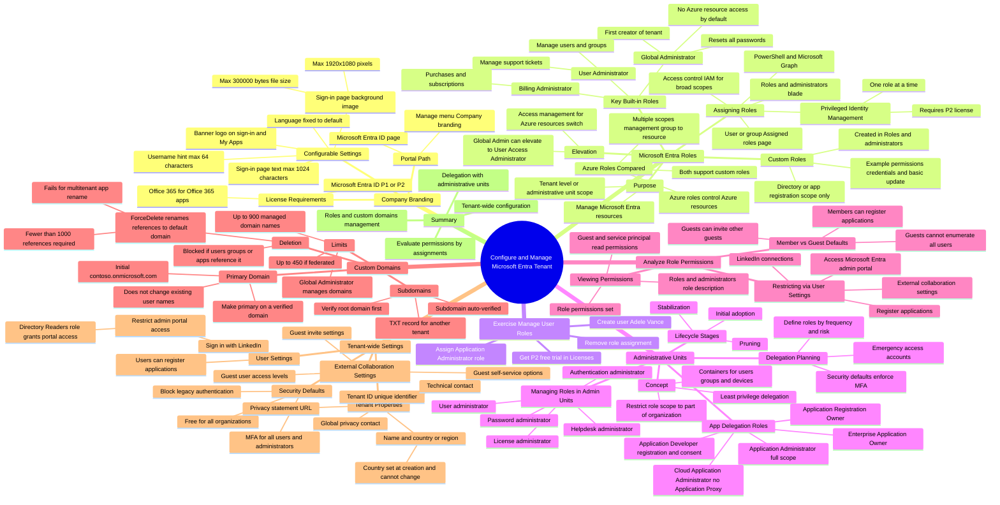


---

# Module 02: Create, configure, and manage users - Mind Map

<details><summary>Source lessons</summary>

- Introduction
- Create, configure, and manage users
- Exercise - assign licenses to users
- Exercise - restore or remove deleted users
- Create, configure, and manage groups
- Exercise - add groups in Microsoft Entra ID
- Configure and manage device registration
- Manage licenses
- Exercise - change group license assignments
- Exercise - change user license assignments
- Create custom security attributes
- Explore automatic user creation
- Summary and resources

</details>

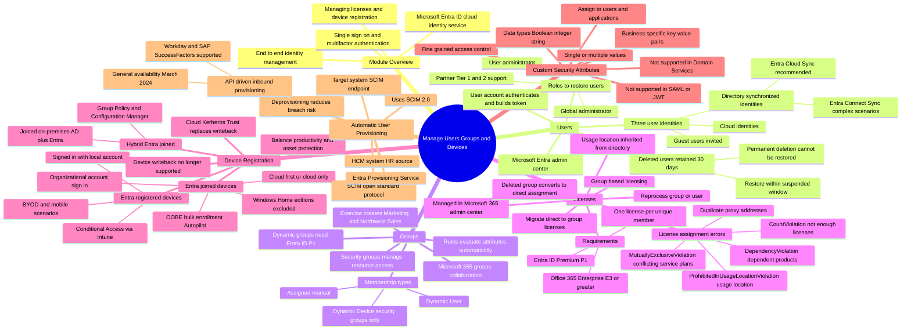


---

# Module 03: Describe guest access and Business to Business accounts - Mind Map

<details><summary>Source lessons</summary>

- Introduction
- Describe guest access and Business to Business accounts
- Manage external collaboration
- Exercise - configure external collaboration
- Invite external users - individually and in bulk
- Exercise - add guest users to directory
- Exercise - invite guest users bulk
- Demo - manage guest users in Microsoft Entra ID
- Manage external user accounts in Microsoft Entra ID
- Manage external users in Microsoft 365 workloads
- Exercise - explore dynamic groups
- Implement and manage Microsoft Entra Verified ID
- Configure identity providers
- Implement cross-tenant access controls
- Summary and resources

</details>

```mermaid
mindmap
  root((Manage external collaboration and B2B))
    Guest access and B2B basics
      B2B collaboration feature
        Part of External Identities
        Invite guest users securely
        Share apps and resources
      Guest user identity
        UserType set to Guest
        UPN contains #EXT# marker
        User object created in directory
      Self-service sign-up user flows
        Users sign up for apps
        Work school or social identity
    External collaboration settings
      Guest user access levels
        Same access as members
        Limited to properties and memberships
        Restricted to own objects
      Guest invite settings
        Everyone can invite guests
        Member users and admins only
        Specific admin roles only
        No one can invite
      Guest Inviter role
        Assigned users can invite
      Collaboration restrictions
        Allowlist or blocklist domains
        Only one policy per organization
        Policy max 25 KB
        Independent of SharePoint lists
      Portal path
        Identity then External Identities
    Inviting guest users
      Individual invitation
        New user then invite external user
        Invite to directory group or app
        User type shows Guest
        Invitation never expires
        Plus symbols not supported
      Bulk invitation
        Bulk operations then Bulk invite
        Download CSV template
        Keep first two rows unchanged
        Remove examples row
        Upload and validate file
        Review bulk operation results
      Self-service app management
        Admin enables group management
        App owner invites via Access Panel
    Managing guest user accounts
      UserType property
        Member versus Guest
        No relation to sign-in method
      Identities property
        External Microsoft Entra tenant
        Microsoft account
        google.com and facebook.com
        mail one-time passcode
        SAML or WS-Fed issuer URI
      Guest privileges
        Can be added to any role
        Remove default guest limitations
        Use least privilege with PIM
      Convert UserType
        Possible with PowerShell
        Not recommended as atomic activity
      Dynamic groups
        Rules based on user attributes
        Requires Premium P1 or P2
        Rule example objectId not null
    Microsoft 365 external users
      Default collaboration settings
        Authenticated sharing enabled
        Shared channels disabled
        Anonymous meeting join enabled
      Governance tools
        Microsoft 365 admin center
        Microsoft Entra admin center
        Graph PowerShell or CLI
    Identity providers
      SAML and WS-Fed federation
        Formerly direct federation
        Tied to domain namespaces
        Only affects new invitations
        Deleting federation blocks sign-in
      SAML 2.0 requirements
        AssertionConsumerService endpoint
        Audience tenant based endpoint
        Issuer URI of partner IdP
        Claims NameID persistent and emailaddress
      WS-Fed requirements
        PassiveRequestorEndpoint
        Claims ImmutableID and emailaddress
        AD FS and Shibboleth tested
      Google federation
        For Gmail users only
        Create Google developer project
        Configure client ID and secret
        All identity providers portal
        Deleting blocks redeemed users
        WebView sign-in deprecated
      Facebook federation
        Self-service sign-up only
        Cannot redeem invitations
        App ID and App Secret
    Cross-tenant access settings
      Inbound access settings
        Control external users coming in
      Outbound access settings
        Control user access to external orgs
      Trust settings
        Trust MFA claims
        Compliant and hybrid joined device
      B2B direct connect
        Mutual trust required both sides
        Works with Teams shared channels
      Organizational and cloud settings
        Per organization configurations
        Microsoft cloud settings
    Microsoft Entra Verified ID
      Verifiable credentials
        Claims from issuer about subject
        Free REST API for verifiers
      Deployment prerequisites
        Azure tenant with subscription
        Premium license required
        Global administrator login
        Azure Key Vault configured
      Setup steps
        Search Verifiable Credentials
        Provide organization name and domain
        Bind DID to domain
```


---

# Module 04: Plan, design, and implement Microsoft Entra Connect - Mind Map

<details><summary>Source lessons</summary>

- Introduction
- Plan, design, and implement Microsoft Entra Connect
- Implement manage password hash synchronization (PHS)
- Implement manage pass-through authentication (PTA)
- Explore pass-through authentication and seamless single sign-on (SSO)
- Implement and manage federation
- Trouble-shoot synchronization errors
- Implement Microsoft Entra Connect Health
- Manage Microsoft Entra Health
- Summary and resources

</details>

```mermaid
mindmap
  root((Implement and Manage Hybrid Identity))
    Introduction
      Hybrid identity spans on-premises and cloud
      Unified authentication and authorization
      Extend AD to Microsoft Entra ID
      Learning objectives
        Plan and implement Entra Connect
        Implement PHS and PTA
        Implement seamless SSO
        Manage federation excluding manual AD FS
        Troubleshoot sync errors
        Implement Connect Health
    Entra Connect Design
      Capabilities
        Synchronization of users and groups
        Password hash synchronization
        Pass-through authentication
        Federation integration
        Health monitoring
      Design concepts
        sourceAnchor immutable attribute
        Also called immutableId
        Max 60 characters length
        objectGuid recommended for single forest
        EmployeeID as stable alternative
      Sign-in with UPN
        UPN suffix must match verified domain
        Non-routable domains need custom install
        contoso.local not verifiable
      Topologies
        Single forest single tenant
        Multiple forests single tenant
        Full mesh with optional GALSync
        Account-resource forest
        One sync server per tenant
        Staging server for standby
    Authentication Methods
      Cloud authentication
        Entra ID handles sign-in
        Works with seamless SSO
      Password hash synchronization
        Simplest method least effort
        Sync runs every 2 minutes
        Hash of the hash only
        Cannot change frequency
        Initial full sync then selective sync
        Backup method for PTA
        FIPS requires MD5 disabled change
        Recommended second server staging mode
      Pass-through authentication
        Agents validate passwords on-premises
        Recommend three agents deployed
        Agents not supported in perimeter network
        Enforces account state and sign-in hours
        Failover to PHS is manual
      Federated authentication
        Hands off to AD FS or PingFederate
        Smartcard and third-party MFA support
        sAMAccountName sign-in scenarios
        Requires farm in perimeter network
        PingFederate 8.4 or later required
      Recommendations
        Enable PHS with any method
        Survives on-premises outages
        Identity Protection needs P2
        Leaked credentials report
    Seamless SSO
      Combined with PHS or PTA
      Not applicable to AD FS
      Deployed via Group Policy
      No extra on-premises components
      Browser sign-in flow
        401 challenge for Kerberos ticket
        AZUREADSSOACC computer account
        Entra ID decrypts Kerberos ticket
      Native client flow
        WS-Trust MEX endpoint
        SAML token issued to app
        OAuth2 access and refresh tokens
    Federation Management
      Prerequisites
        Local admin on federation servers
        Local admin on workgroup WAP servers
        Windows Remote Management access
      Setup steps
        Specify AD FS servers domain joined
        Specify Web Application Proxy servers
        Perimeter network placement
        Group managed service account
        Federate one domain initially
      Wizard tasks
        Repair the trust
        Alternate sign-in ID setup
        Add federated domain
        Device writeback for conditional access
    Troubleshooting Sync Errors
      Operations
        Import Synchronization Export
        Export errors to Entra ID
      InvalidSoftMatch
        Hard match uses sourceAnchor
        Soft match uses ProxyAddresses and UPN
        Fix duplicate attributes at source
      ObjectTypeMismatch
        Different object types same proxyAddress
        User and group conflict example
      AttributeValueMustBeUnique
        ProxyAddresses and UPN must be unique
        Duplicate attribute resiliency feature
      IdentityDataValidationFailed
        Invalid UPN characters or format
      FederatedDomainChangeError
        UPN suffix change between federated domains
      LargeObject error
        userCertificate limit of 15
        thumbnailPhoto too large
      Admin role conflict
        Remove roles and hard delete
        Restore roles after soft match
      Diagnose tool statuses
        Not Started
        Manual Fix Required
        Pending Sync
    Connect Health
      Licensing and requirements
        Requires Entra ID Premium P1
        Global administrator required
        Agent on each targeted server
        FIPS must be disabled
        Ports 443 and 5671
        Latest agent only needs 443
        PowerShell 4.0 or newer
      Agent types
        AD FS agent on separate server
        Sync agent installed automatically
        Diagnostics Insights Monitoring services
      Sync error reports
        Updated every 30 minutes
        Viewed in Azure portal
    Managing Health
      Email notifications
        Enabled by default
        Daily digest of sync errors
        Additional recipients supported
      Deleting servers or services
        Stops data collection
        Does not uninstall agent
        Reinstall agent to resume monitoring
      Azure RBAC roles
        Owner manages access and settings
        Contributor views and changes settings
        Reader views all information
        Global admins default Owner
        Contributor needed for Diagnose feature
      Access scope
        All service instances recommended
        Individual service instance scope
    Summary
      Implement PHS PTA and seamless SSO
      Manage federation excluding manual AD FS
      Troubleshoot synchronization errors
      Implement and manage Connect Health
```


---

# Module 04: Plan, design, and implement Microsoft Entra Connect - Mind Map (part 1)

<details><summary>Source lessons</summary>

- Introduction
- Plan, design, and implement Microsoft Entra Connect
- Implement manage password hash synchronization (PHS)
- Implement manage pass-through authentication (PTA)
- Explore pass-through authentication and seamless single sign-on (SSO)
- Implement and manage federation
- Trouble-shoot synchronization errors
- Implement Microsoft Entra Connect Health

</details>

```mermaid
mindmap
  root((Hybrid Identity with Microsoft Entra ID))
    Introduction
      Hybrid identity spans on-premises and cloud
      Unified authentication and authorization
      Microsoft Entra Connect bridges directories
      Learning objectives
        Plan and implement Entra Connect
        Manage PHS and PTA
        Seamless SSO and federation
        Troubleshoot sync errors
        Entra Connect Health
    Plan and Implement Entra Connect
      Capabilities
        Synchronization of users and groups
        Password hash synchronization
        Pass-through authentication
        Federation integration
        Health monitoring
      Authentication methods
        Cloud authentication
          PHS simplest option
          PTA validates against on-premises AD
          Seamless SSO improves experience
        Federated authentication
          AD FS or PingFederate
          Smartcards and third-party MFA
          sAMAccountName sign-in
      Recommendations
          Enable PHS with any method
          Survive on-premises outages
          Identity Protection needs P2
      Design concepts
        sourceAnchor immutableId
          Fewer than 60 characters
          objectGuid for single forest
          Must be globally unique
        UPN sign-in
          Must match verified domain
          Non-routable domains need custom settings
      Topologies
        Single forest single tenant
        Multiple forests single tenant
        Account-resource forest
        Staging server standby
        One sync server per tenant
      Components
        Connector Space
        Metaverse
        Sync rules
        Run profiles
      Cloud sync
        Lightweight provisioning agents
        Multi-forest disconnected environments
        Large groups up to 50000 members
        Sync runs every 2 minutes
    Password Hash Synchronization
      How it works
        Hash of the hash synchronized
        Runs every 2 minutes
        Cannot modify frequency
        Overwrites existing cloud password
        Selective PHS after initial sync
      Enablement
        Enabled by Express Settings
        Available in custom settings
      FIPS consideration
        MD5 disabled on FIPS servers
        Edit miiserver.exe.config
        enforceFIPSPolicy disabled
      PingFederate
        Version 8.4 or later
        TLS SSL certificate required
    Pass-through Authentication
      Validates passwords against on-premises AD
      Enable via Entra Connect
        Custom installation path
        Change user sign-in task
      Agent requirements
        Recommend three agents
        Not supported in perimeter network
        Needs outbound internet access
      Tenant-level feature
        Affects all managed domains
        Wait 12 hours before AD FS shutdown
      PHS as backup method
        Manual failover only
    Seamless Single Sign-On
      Automatic sign-in on corporate desktops
      Combines with PHS or PTA
      Not applicable to AD FS
      Benefits
        No repeated password prompts
        No extra on-premises components
        Roll out with Group Policy
      Browser flow
        Kerberos ticket challenge
        AZUREADSSOACC computer account
        Entra ID decrypts ticket
      Native client flow
        WS-Trust MEX endpoint
        SAML token issued
        Access and refresh tokens
    Federation
      Trust between domains
      All authentication occurs on-premises
      AD FS Windows Server 2012 R2 or later
      Deployment requirements
        Local admin credentials
        Windows Remote Management access
      Setup steps
        Specify AD FS servers
        Specify Web Application Proxy servers
        Perimeter network placement
        Group managed service account
        Select domain to federate
      Management tasks
        Repair the trust
        Alternate sign-in ID
        Add federated domain
        Device writeback
          Conditional Access for ADFS devices
          RegisteredDevices container
    Troubleshoot Synchronization Errors
      Operations
        Import
        Synchronization
        Export
      Report in Entra Connect Health
        Updated every 30 minutes
      Data mismatch errors
        InvalidSoftMatch
          Hard Match uses sourceAnchor
          Soft Match uses ProxyAddresses and UPN
          Duplicate immutableId conflict
        ObjectTypeMismatch
          Different object types same proxyAddress
      Duplicate attributes
        AttributeValueMustBeUnique
          ProxyAddresses must be unique
          UserPrincipalName must be unique
      Data validation failures
        IdentityDataValidationFailed
          Invalid UPN characters or format
        FederatedDomainChangeError
          UPN suffix between federated domains
      LargeObject
        ExceededAllowedLength
        userCertificate limit 15 certificates
        thumbnailPhoto too large
      Admin role conflict
        No soft-match for admin users
        Remove roles and hard delete
    Entra Connect Health
      Monitors on-premises identity infrastructure
      Requires Entra ID Premium P1
      Portal features
        Alerts
        Performance monitoring
        Usage analytics
      Requirements
        Global administrator role
        Agent on each targeted server
        Outbound connectivity to endpoints
        PowerShell 4.0 or newer
        FIPS disabled
      Firewall ports
        TCP port 443
        TCP port 5671 for older agents
      Agent installation
        AD FS agent
          Separate from sync server
          Diagnostics Insights Monitoring services
        Sync agent
          Installed automatically with Connect
          Insights and Monitoring services
```


---

# Module 04: Plan, design, and implement Microsoft Entra Connect - Mind Map (part 2)

<details><summary>Source lessons</summary>

- Manage Microsoft Entra Health
- Summary and resources

</details>

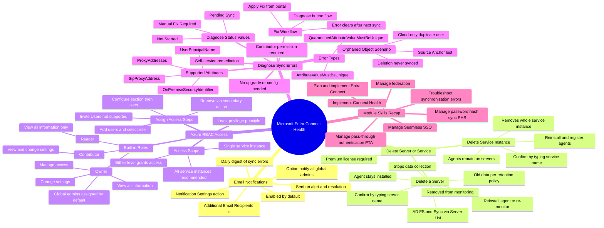


---

# Module 05: What is Microsoft Entra multifactor authentication - Mind Map

<details><summary>Source lessons</summary>

- Introduction
- What is Microsoft Entra multifactor authentication
- Plan your multifactor authentication deployment
- Exercise - Enable Microsoft Entra multifactor authentication
- Configure multifactor authentication methods
- Summary

</details>

```mermaid
mindmap
  root((Microsoft Entra MFA))
    Introduction
      Scenario
        Protect confidential client designs
        User accounts are the weak point
      Learning objectives
        Learn Entra multifactor authentication
        Plan MFA deployment
        Enable MFA for users and apps
      Prerequisites
        Basic Azure portal knowledge
        Basic Microsoft Entra ID knowledge
    What is MFA
      Password risk mitigation
        Password complexity rules
        Password expiration rules
        Self-service password reset SSPR
        Entra ID Protection risk policies
        Entra password protection banned list
        Entra smart lockout
        Entra application proxy
        Single sign-on SSO
        Entra Connect hybrid sync
      Three authentication categories
        Something you know
        Something you possess
        Something you are biometric
      Key exam points
        Requires two or more elements
        Most effective way to stop sign-in
        Layered approach defeats stolen passwords
    Licensing and entitlement
      Microsoft Entra ID P1 or P2
      Microsoft 365 Business
        Uses security defaults
      Entra ID Free
        Security defaults for all users
      Standalone Microsoft 365 licenses
    Plan the deployment
      Rollout in waves
        Start with pilot users
        Identify setup issues
        Broaden group over time
      Communication plan
        Registration requirements
        Important dates for users
        Microsoft communication templates
      Conditional Access policies
        IF user accesses resource
        THEN complete an action
        Common trigger scenarios
          Specific cloud application
          Specific network access
          Specific client application
          Registering a new device
      Registration enforcement options
        Entra ID Protection prompt
        Prompt on app access
        Conditional Access policy on group
        Manual group review needed
    Authentication methods
      Mobile app verification code
        OATH code every 30 seconds
        Works with limited connectivity
        Not on Android in China
      Mobile app push notification
        Microsoft Authenticator approval
      Call to phone
        Approve using keypad
        Preferred for backups
      FIDO2 security key
        Unphishable passwordless standard
        USB Bluetooth or NFC
      Windows Hello for Business
        Biometric or PIN on device
      OATH tokens
        Software or hardware tokens
    Configure methods details
      Password
        Only method you cannot disable
      Security questions
        SSPR only non-admin accounts
        35 predefined localized questions
        Max 200 characters custom
        Admin cannot read answers
      Email address
        SSPR only
      Microsoft Authenticator app
        Android and iOS supported
        Push notification approve or deny
        Software OATH token codes
      OATH hardware tokens
        OATH-TOTP SHA-1 supported
        30 or 60 second types
        Secret key max 128 characters
      App passwords
        For non-browser apps
        Enabled in service settings
      Voice call limitation
        Not available free or trial tier
    Enable MFA exercise
      Portal path
        Sign in as Authentication Administrator
        Entra ID then Security
        Manage Multifactor authentication
        Additional cloud-based settings
      Create Conditional Access policy
        Name the policy
        Include users and groups
        Target cloud apps
        Conditions any location
        Grant access require MFA
        Enable policy then Create
    Monitoring and summary
      Usage and insights view
        Under Monitoring section
        Registration success and failure
        Last 30 days audit logs
        Drill down per user
      Summary takeaways
        Protect specific apps with policy
        Combine with ID Protection
        Combine with smart lockout
```


---

# Module 06: Administer FIDO2 and passwordless authentication methods - Mind Map

<details><summary>Source lessons</summary>

- Introduction
- Administer FIDO2 and passwordless authentication methods
- Explore Authenticator app and OATH tokens
- Implement an authentication solution based on Windows Hello for Business
- Exercise configure and deploy self-service password reset
- Deploy and manage password protection
- Configure smart lockout thresholds
- Exercise - Manage Microsoft Entra smart lockout values
- Implement Kerberos and certificate-based authentication in Microsoft Entra ID
- Configure Microsoft Entra user authentication for virtual machines
- Summary and resources

</details>

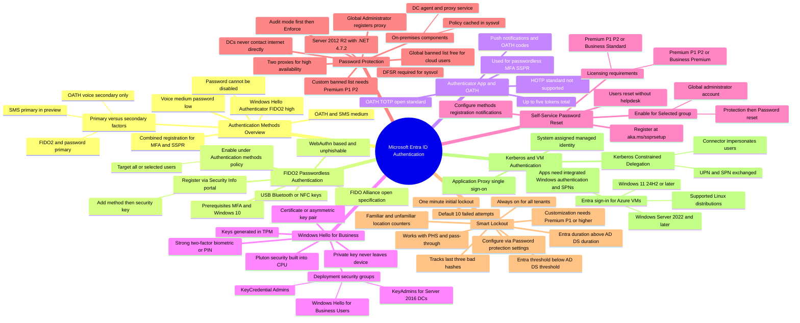


---

# Module 07: Plan security defaults - Mind Map

<details><summary>Source lessons</summary>

- Introduction
- Plan security defaults
- Exercise - Work with security defaults
- Plan Conditional Access policies
- Implement Conditional Access policy controls and assignments
- Exercise - Implement Conditional Access policies roles and assignments
- Test and troubleshoot Conditional Access policies
- Implement application controls
- Implement session management and continuous access evaluation
- Exercise - Configure authentication session controls
- Microsoft Entra Conditional Access Optimization agent
- Summary and resources

</details>

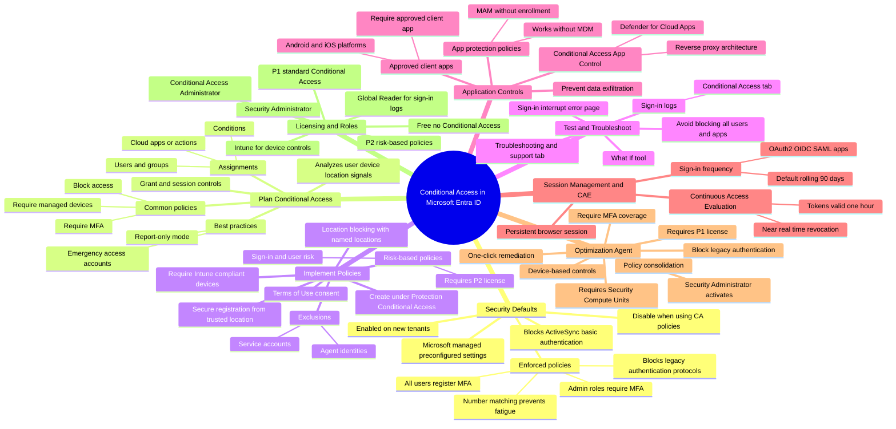


---

# Module 08: Review identity protection basics - Mind Map

<details><summary>Source lessons</summary>

- Introduction
- Review identity protection basics
- Implement and manage user risk policy
- Exercise enable sign-in risk policy
- Exercise configure Microsoft Entra multifactor authentication registration polic
- Monitor, investigate, and remediate elevated risky users
- Implement security for workload identities
- Explore Microsoft Defender for Identity
- Explore the Identity Risk Management Agent
- Summary and resources

</details>

```mermaid
mindmap
  root((Identity Protection))
    Introduction
      Learning objectives
        Review Identity Protection basics
        Implement user risk policy
        Implement sign-in risk policies
        Implement MFA registration policy
        Monitor and remediate risky users
        Explore Defender for Identity
    Identity Protection Basics
      Key tasks
        Automate detection and remediation
        Investigate risks in portal
        Export risk data to third parties
      Signals analyzed daily
        6.5 trillion signals
      Risk detection types
        Anonymous IP address
        Atypical travel
        Malicious IP address
        Unfamiliar sign-in properties
        Leaked credentials
        Password spray
        Entra threat intelligence
        Anomalous token
        Token issuer anomaly
        Suspicious browser
        Verified threat actor IP
        MDCA detections
          New country
          Suspicious inbox forwarding
      Admin roles
        Security Administrator
          Full access
        Security Operator
          Cannot access risky sign-ins report
        Security Reader
          View only
        Global Reader
        Conditional Access Administrator
      Licensing
        Requires Entra ID Premium P2
        Free tier limited reports
        P1 limited risk detections
        P2 full access and notifications
    Risk Policies
      User risk policy
        Detects compromised account probability
        Recommended threshold High
        Control Require password change
      Sign-in risk policy
        Detects suspicious sign-in activity
        Recommended threshold Medium and above
        Control Require MFA
      MFA registration policy
        Require MFA registration control
        Cannot be changed
      Prerequisites
        Register users for MFA and SSPR
        Combined security information registration
      Exclusions
        Emergency access accounts
        Review exclusions regularly
      Trusted network locations
        Reduce false positives
    Portal Configuration Path
      Entra admin center
        Identity
          Protection
            Identity Protection blade
              User risk policy
              Sign-in risk policy
              MFA registration policy
      Enforce policy On then Save
    Investigate Reports
      Risky users report
        Risk history
        Reset password
        Confirm compromise
        Dismiss user risk
        Block user sign-in
      Risky sign-ins report
        Past 30 days
        Real-time and aggregate risk levels
        Conditional Access policies applied
        Confirm compromised or safe
      Risk detections report
        Past 90 days
        Detection type and location
        Link to MDCA portal
      Download limits
        2500 entries users and sign-ins
        5000 records risk detections
      CSV and JSON export
      AI confirmed sign-in safe
    Remediation and Unblocking
      Self-remediation
        Requires MFA and SSPR registration
      Manual password reset
        Generate temporary password
        Require user reset password
      Dismiss user risk
        Does not secure the identity
      Close detections manually
        Confirm user compromised
        Confirm sign-in safe
      Unblock by user risk
        Reset password
        Exclude user from policy
        Disable policy
      Unblock by sign-in risk
        Sign in from familiar location
        Exclude user from policy
    Microsoft Graph API
      Three APIs
        riskDetection
        riskyUsers
        signIn
      App registration steps
        Retrieve domain name
        Register application
        API permissions
          IdentityRiskEvent.Read.All
          IdentityRiskyUser.Read.All
        Client secret credential
      Query examples
        Offline detections filter
        Users passed MFA driven by policy
    Workload Identities
      Definition
        Application or service principal identity
        Cannot perform MFA
        No formal lifecycle
        Store credentials somewhere
      Requirements
        Entra ID Premium P2
        Security admin or operator or reader
      Detections
        Entra threat intelligence
        Suspicious sign-ins
          Learns baseline in 2 to 60 days
        Unusual credential addition to OAuth app
        Admin confirmed compromised
        Leaked credentials
      Conditional Access for workload identities
        Single-tenant service principals only
        Managed identities out of scope
    Defender for Identity
      Formerly Azure Advanced Threat Protection
      Uses on-premises Active Directory signals
      Components
        Microsoft Defender portal
          security.microsoft.com
        Defender for Identity sensor
          Domain controllers
          AD FS
        Cloud service
          Azure infrastructure
    Identity Risk Management Agent
      Uses Large Language Model
      Prerequisites
        Entra ID P2 license
        Security compute units
        Security Administrator to activate
        Security Reader view only
      Agent steps
        Investigate risky user
        Generate findings and risk summary
        Recommend remediation action
        Answer questions via chat
        Store custom instructions in memory
      Settings
        Triggers
          Continuous every 5 minutes
          Daily trigger
          Manual run
        Scope
          Most recent 100 risky users
          Last 90 days
        Communications
        Memory
      Remediation actions
        Dismiss risk
        Reset password
```


---

# Module 09: Assign Azure roles - Mind Map

<details><summary>Source lessons</summary>

- Introduction
- Assign Azure roles
- Configure custom Azure roles
- Create and configure managed identities
- Access Azure resources with managed identities
- Analyze Azure role permissions
- Configure Azure Key Vault RBAC policies
- Retrieve objects from Azure Key Vault
- Summary and resources

</details>

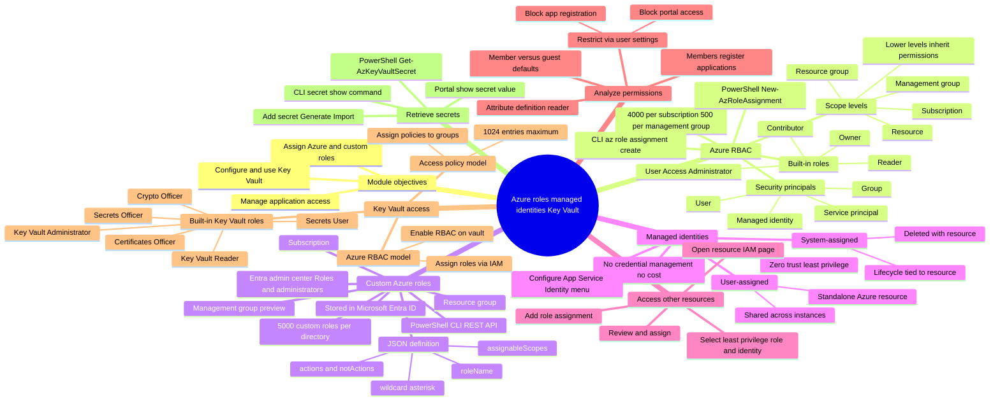


---

# Module 10: Explore Global Secure Access - Mind Map

<details><summary>Source lessons</summary>

- Introduction
- Explore Global Secure Access
- Deploy and configure Microsoft Entra Internet Access
- Deploy and configure Microsoft Entra Private Access
- Explore how to use the Dashboard to drive Global Secure Access
- Create remote networks for use with Global Secure Access
- Use Conditional Access with Global Secure Access
- Explore logs and monitoring options with Global Secure Access
- Summary and resources

</details>

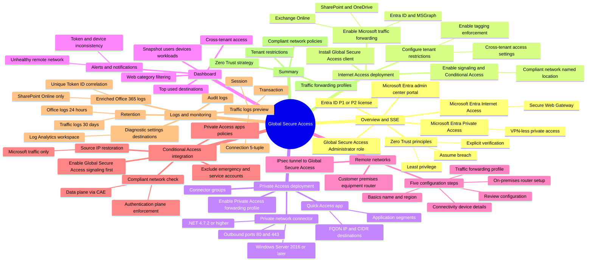


---

# Module 11: Discover apps by using Microsoft Defender for Cloud Apps and Active Directory Fe - Mind Map

<details><summary>Source lessons</summary>

- Introduction
- Discover apps by using Microsoft Defender for Cloud Apps and Active Directory Fe
- Configure connectors to apps
- Exercise implement access management for apps
- Design and implement app management roles
- Exercise create a custom role to manage app registration
- Configure preintegrated gallery SaaS apps
- Implement and manage policies for OAuth apps
- Summary and resources

</details>

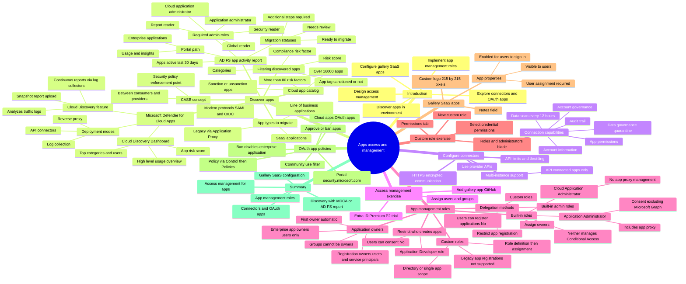


---

# Module 12: Implement token customizations - Mind Map

<details><summary>Source lessons</summary>

- Introduction
- Implement token customizations
- Implement and configure consent settings
- Integrate on-premises apps with Microsoft Entra application proxy
- Integrate custom SaaS apps for single sign-on
- Implement application-based user provisioning
- Monitor and audit access to Microsoft Entra integrated enterprise applications
- Create and manage application collections
- Summary and resources

</details>

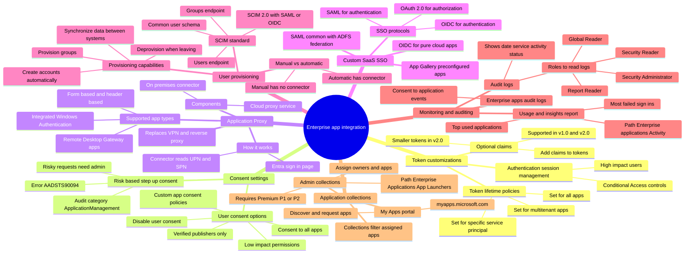


---

# Module 13: Plan your line of business application registration strategy - Mind Map

<details><summary>Source lessons</summary>

- Introduction
- Plan your line of business application registration strategy
- Implement application registration
- Register an application
- Configure permission for an application
- Grant tenant-wide admin consent to applications
- Implement application authorization
- Exercise add app roles to an application and receive tokens
- Manage and monitor application by using app governance
- Summary and resources

</details>

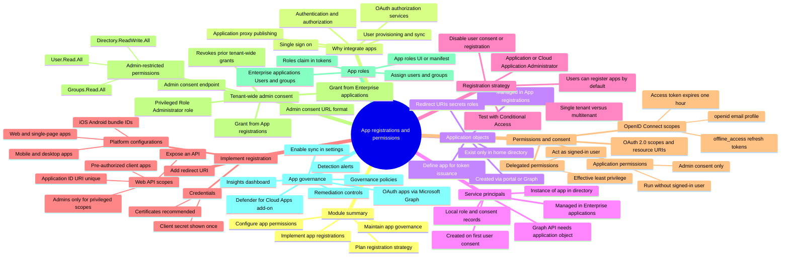


---

# Module 14: Plan for app registration - Mind Map

<details><summary>Source lessons</summary>

- Introduction
- Plan for app registration
- Explore application objects and service principals
- Create app registrations
- Configure app authentication
- Configure API permissions
- Create app roles
- Summary

</details>

```mermaid
mindmap
  root((App Registration in Microsoft Entra ID))
    Introduction and Benefits
      Identity configuration for apps
      Custom branding in sign-in dialog
      Tenant configuration choices
      Request scope permissions
      Confidential client applications
    Single versus Multitenant Apps
      Single-tenant apps
        Home tenant only
        Accounts in this directory only
      Multitenant apps
        Users from other tenants
        Service principal per tenant
      Personal Microsoft accounts supported
      Audience setting in admin center
    Application Objects
      Blueprint or template of app
      Resides in home tenant
      One-to-one with the application
      Describes token issuance
      Describes needed resources
      Describes app actions
      Certificates preferred over secrets
    Service Principals
      Instance of the application
      One-to-many with application object
      Types
        Application principal
        Managed identity
          Preferred for Azure workloads
          Eliminates credential management
        Legacy principal
      Managed application in local directory
    Create App Registrations
      Requires Application Developer role
      Admin center path


---

# Module 15: Define access packages - Mind Map

<details><summary>Source lessons</summary>

- Introduction
- Define access packages
- Exercise create and manage a resource catalog with Microsoft Entra entitlement m
- Configure entitlement management
- Exercise add terms of use acceptance report
- Exercise manage the lifecycle of external users with Microsoft Entra identity go
- Configure and manage connected organizations
- Review per-user entitlements
- Summary and resources

</details>

```mermaid
mindmap
  root((Entitlement Management))
    Why Entitlement Management
      Users lack correct access
      Access held too long
      Auto invite and remove B2B
    Key Terminology
      Access package bundles resources
      Access request approval workflow
      Assignment time limited
      Catalog container of resources
      Catalog creator creates catalogs
      Connected organization external directory
      Policy defines access lifecycle
      Resource role permissions
    Access Packages
      Manageable resources
        Security groups
        Microsoft 365 Groups and Teams
        Enterprise applications S


---

# Module 16: Plan for access reviews - Mind Map

<details><summary>Source lessons</summary>

- Introduction
- Plan for access reviews
- Create access reviews for groups and apps
- Create and configure access reviews programmatically
- Monitor access review findings
- Automate access review management tasks
- Configure recurring access reviews
- Explore the Access Review Agent in Microsoft Entra
- Summary and resources

</details>

```mermaid
mindmap
  root((Access Reviews Module))
    Planning Access Reviews
      What is an Access Review
        Planned review of user access
        Right people right access right resources
        Requires Entra ID Governance license
        Some capabilities work with P2
        Entra Suite also qualifies
      Engage Stakeholders
        IT administration
        Security teams
        Development teams
        Business units
        Corporate governance
      Four Governance Questions
        Who should have access
        What users do with access
        Are controls effective
        Can auditors verify controls
      Pilot Recommendations
        Start with noncritical resources
        No auto apply initially
        Document removed access
        Monitor audit logs
      Resource Types Reviewed
        Apps with SSO
        Group memberships
        Access packages
        Entra roles and Azure roles
        Custom data resources preview
    Roles and Licensing
      Create and Manage Reviews
        Global Administrator
        Identity Governance Administrator
        User Administrator
        Privileged Role Administrator
        Group Owner
        User Access Administrator for Azure roles
      Read Review Results
        Global Reader
        Security Reader
        Resource Owner
      Licensing Rules
        P2 for reviewers and self reviewers
        P2 for group and app owners reviewing
        No license for admins configuring reviews
    Create Reviews for Groups and Apps
      Portal Path
        ID Governance then Access reviews
        New access review
        Identity Governance Administrator needed
      Teams and Groups Options
        All Microsoft 365 groups with guest users
        Select teams plus groups
      Scope Options
        Guest users only
        Everyone
        Inactive users up to 730 days
      Reviewer Selection
        Group owners
        Selected users or groups
        Users review own access
        Managers of users
        Fallback reviewers
      Recurrence Settings
        Weekly Monthly Quarterly
        Semi-annually Annually
        Monthly max duration 27 days
      Upon Completion Settings
        Auto apply results to resource
        No change
        Remove access
        Approve access
        Take recommendations
      Denied Guest User Actions
        Remove membership from resource
        Block sign in 30 days then remove
      Review Statuses
        NotStarted Initializing Starting
        InProgress Completing
        Auto-Reviewing Auto-Reviewed
        Applying Applied Failed
    Programmatic Management
      Microsoft Graph API
        AccessReview.ReadWrite.All permission
        Create access review schedule definition
        AccessReview.Read.All for read
        Use Graph Explorer for testing
      PowerShell
        New-MgIdentityGovernanceAccessReviewDefinition
      API Automation Tasks
        Create and start reviews
        End review early
        List running reviews
        Collect decisions
    Monitor Findings
      My Access Portal
        myaccess.microsoft.com
        Access reviews left menu
      Decision Options
        Approve Deny
        Don't know keeps access
        Last reviewer response recorded
      Recommendations
        No sign-in within 30 days
        Peer outlier analysis
        Accept recommendations in bulk
    Automation and Guests
      Auto Apply Results
        Denied users removed automatically
        Removal of membership assignment or elevation
      Guest User Reviews
        Review Everyone or Guest users only
        External identities via B2B
        Sources of guest access
        Groups Teams apps packages roles
      On-Premises Groups
        Cannot change synced memberships
        Source of authority is on-premises
        Results via CSV or Graph
    Recurring Reviews
      Series End Options
        Never
        Specific end date
        Number of occurrences
      Updating a Series
        Apply to Current instance
        Apply to Series
        Replace departed reviewers
    Access Review Agent
      Overview
        AI guided reviews in Teams
        Natural language decisions
        Generates approve deny with justification
      Signals Used
        User inactivity
        User-to-Group affiliation
        Account enabled
        Employment status
        Lifecycle workflow history
        Previous review decisions
        Access request history
      Prerequisites
        Entra ID Governance or Suite
        Security Copilot with one SCU
        Identity Governance Administrator
        Lifecycle Workflows Administrator
        Security Copilot Contributor
        Reviewers need Teams access
      Limitations and Enablement
        Cannot stop or pause agent
        Start from Entra admin center Agents
        Enable in review Advanced Settings
    Monitoring and Communications
      Audit Logs
        Category Policy
        Create Update Delete reviews
        Approve Deny Reset Apply decisions
        Export to Log Analytics or Event Hubs
      Reviewer Emails
        Reminder halfway before expiry
        Customize additional content
        My Access portal for reviewers
```


---

# Module 17: Define a privileged access strategy for administrative users - Mind Map

<details><summary>Source lessons</summary>

- Introduction
- Define a privileged access strategy for administrative users
- Configure Privileged Identity Management for Azure resources
- Exercise configure Privileged Identity Management for Microsoft Entra roles
- Exercise assign Microsoft Entra roles in Privileged Identity Management
- Exercise assign Azure resource roles in Privileged Identity Management
- Plan and configure Privileged Access Groups
- Analyze Privileged Identity Management audit history and reports
- Create and manage emergency access accounts
- Summary and resources

</details>

```mermaid
mindmap
  root((Privileged Identity Management))
    PIM Overview
      Service in Microsoft Entra ID
      Requires Premium P2 license
      Just-in-time privileged access
      Time-bound assignments
      Approval-based activation
      Enforce MFA on activation
      Justification and notifications
      Access reviews
    Access Strategy
      Identify stakeholders
      Least privilege
        Reduce Global Administrators
        Assign granular built-in roles
        Access reviews for cleanup
      Roles to protect
        Global Administrator
        Security Administrator
        User Administrator
        Exchange Administrator
        Azure Owner role
        User Access Administrator
        Roles with guest users
      Group-based assignment
        Role-assignable groups
        Delegate to group owners
      Eligible versus permanent
        Zero standing administrators
        Two


---

# Module 18: Analyze and investigate sign-in logs to troubleshoot access issues - Mind Map

<details><summary>Source lessons</summary>

- Introduction
- Analyze and investigate sign-in logs to troubleshoot access issues
- Review and monitor Microsoft Entra audit logs
- Exercise connect data from Microsoft Entra ID to Microsoft Sentinel
- Export logs to third-party security information and event management system
- Analyze Microsoft Entra workbooks and reporting
- Monitor security posture with Identity Secure Score
- Summary and resources

</details>

```mermaid
mindmap
  root((Monitoring Microsoft Entra ID))
    Reporting architecture
      Activity
        Sign-ins
        Audit logs
        Provisioning logs
      Security
        Risky sign-ins
        Users flagged for risk
    Sign-in logs
      All editions and Graph API
      Up to two hours delay
      Interactive sign-ins only
      Filters
        User UPN and status
        IP address and location
        Client app
        Conditional Access
      CA tab shows policy results
      Download 250,000 records
      Reader roles
        Security Administrator
        Security Reader
        Global Reader
        Report Reader
    Audit logs
      System activity for compliance
      Filters
        Service and category
        Activity and status
        Target and initiator
      Date range
        7 days or 24 hours
        Custom range
      Preselected filtered views
        Users tab UserManagement
        Groups tab GroupManagement
        Enterprise applications
      Download 250,000 records
    Microsoft Sentinel
      Cloud-native SIEM and SOAR
      Collect detect investigate respond
      Sign-in logs need P1 or P2
      Other logs any edition
      Sentinel Contributor role
      Security Administrator role
      Connect via data connectors
      Stream sign-in and audit logs
    Export to third-party SIEM
      Azure Monitor single pipeline
      Route via Event Hubs
      Multiple diagnostic settings
      AzLog deprecated tool
      Splunk Azure Monitor Add-On
      QRadar DSM and protocol
      ArcSight smart connector
    Workbooks and reporting
      Usage and insights report
      Application-centric sign-in view
      Needs P1 or P2 license
      Security or Report Reader roles
      Enterprise applications path
      Sort successes failures rate
      Top errors per application
    Identity Secure Score
      Percentage of best practices
      All editions available
      Path Security Identity Secure Score
      Comparison and trend graphs
      Improvement actions list
      Binary or partial scoring
      Balance security usability
    Summary
      Troubleshoot sign-in issues
      Monitor audit logs
      Integrate Log Analytics Sentinel
      Export logs to SIEM
      Analyze workbooks reports
      Track identity secure score
      Configure notifications
```
