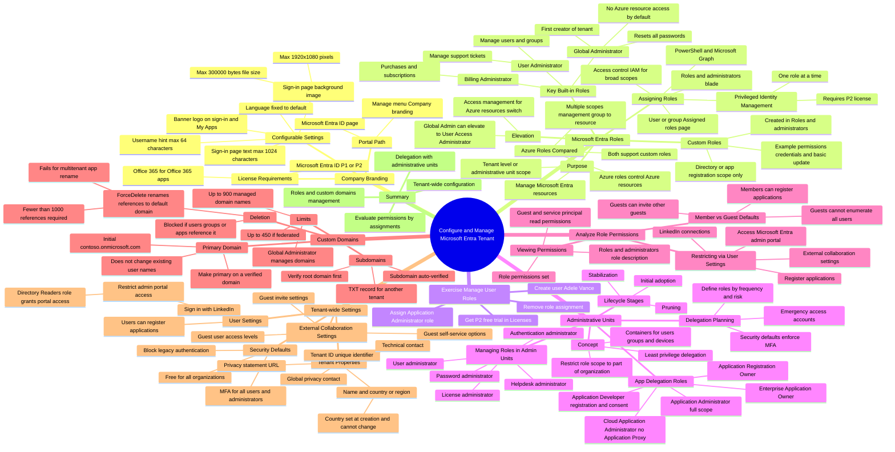

# Module 01: Configure company brand - Mind Map

Source lessons

- Introduction
- Configure company brand
- Configure and manage Microsoft Entra roles
- Exercise manage users roles
- Configure delegation by using administrative units
- Analyze Microsoft Entra role permissions
- Configure and manage custom domains
- Configure tenant-wide setting
- Exercise - setting tenant-wide properties
- Summary and resources

