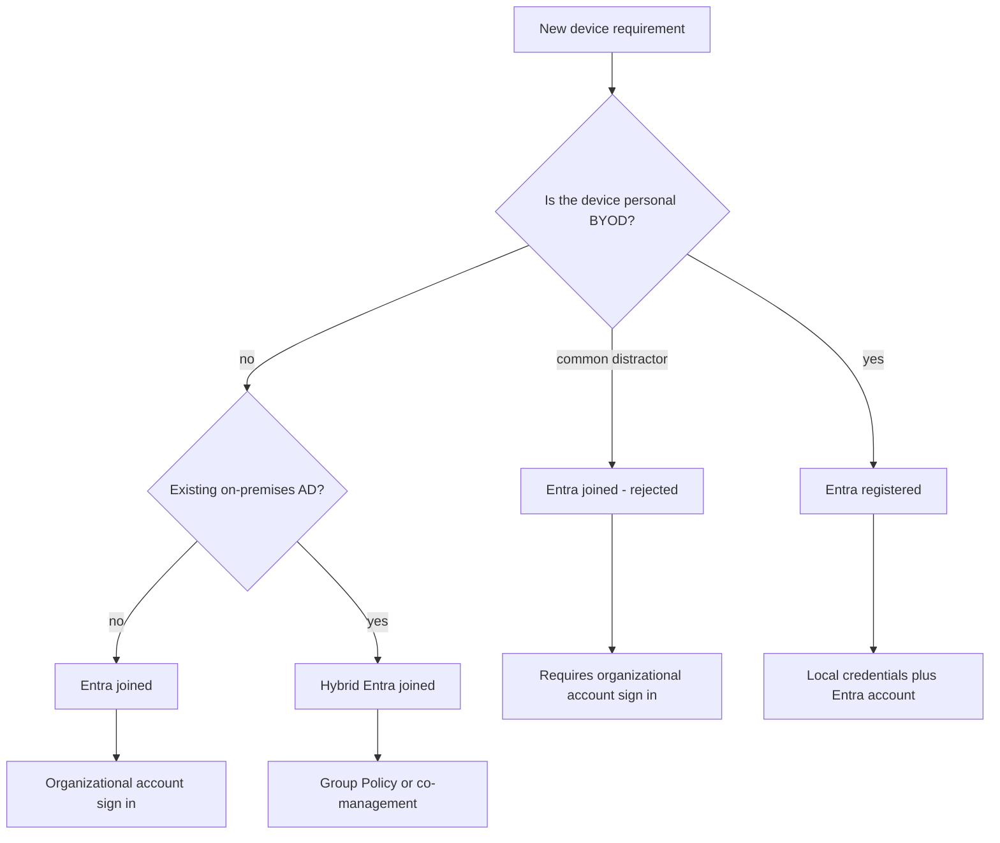

# Module 02: Create, configure, and manage users - Diagrams

<details><summary>Source lessons</summary>

- Introduction
- Create, configure, and manage users
- Exercise - assign licenses to users
- Exercise - restore or remove deleted users
- Create, configure, and manage groups
- Exercise - add groups in Microsoft Entra ID
- Configure and manage device registration
- Manage licenses
- Exercise - change group license assignments
- Exercise - change user license assignments
- Create custom security attributes
- Explore automatic user creation
- Summary and resources

</details>

### Device identity option decision tree
Use this to pick the correct device option for a BYOD, cloud-first, or existing-AD scenario and to spot the classic trap of choosing Entra joined for personal devices.



### Group type and membership type decision tree
Use this to match a group requirement to the right group type and membership type, especially the dynamic device rule that only security groups support and the P1 license requirement for dynamic membership.

```mermaid
flowchart TD
    A["Group requirement"] --> B{"Main purpose?"}
    B -->|"control access to resources"| C["Security group"]
    B -->|"collaboration mailbox calendar files"| D["Microsoft 365 group"]
    C --> E{"How are members managed?"}
