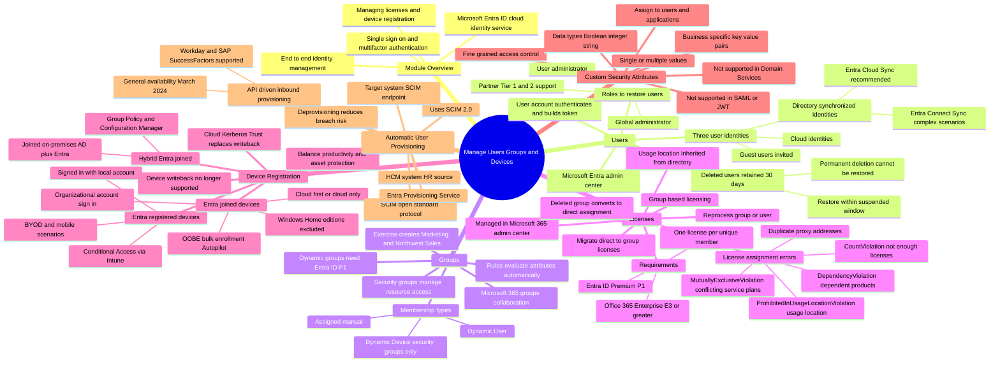

# Module 02: Create, configure, and manage users - Mind Map

Source lessons

- Introduction
- Create, configure, and manage users
- Exercise - assign licenses to users
- Exercise - restore or remove deleted users
- Create, configure, and manage groups
- Exercise - add groups in Microsoft Entra ID
- Configure and manage device registration
- Manage licenses
- Exercise - change group license assignments
- Exercise - change user license assignments
- Create custom security attributes
- Explore automatic user creation
- Summary and resources

