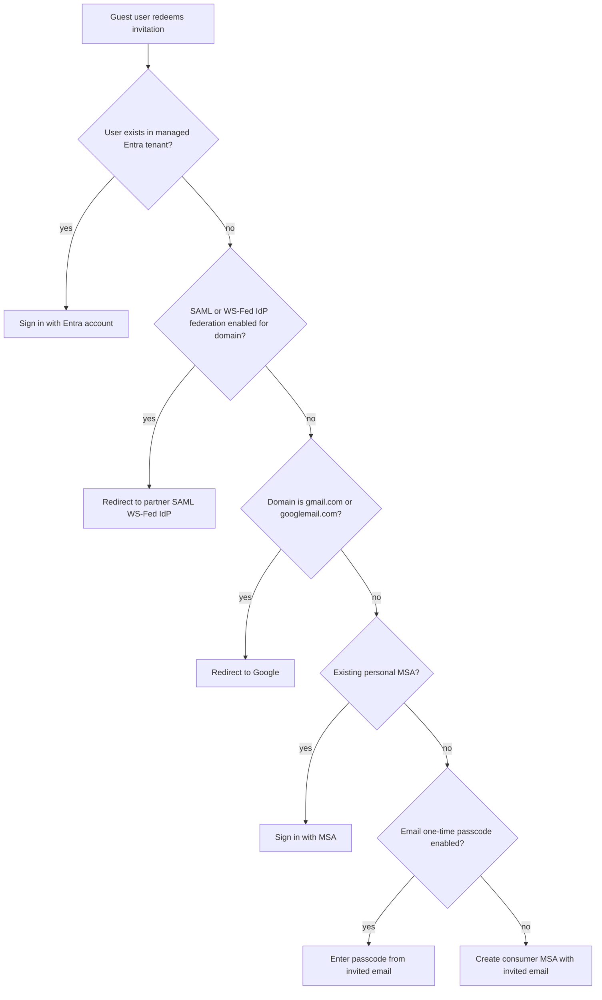
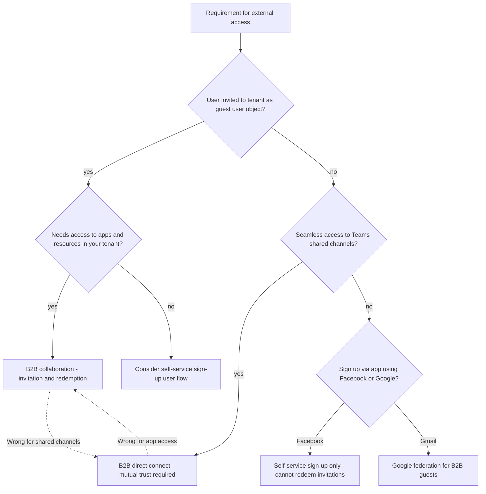
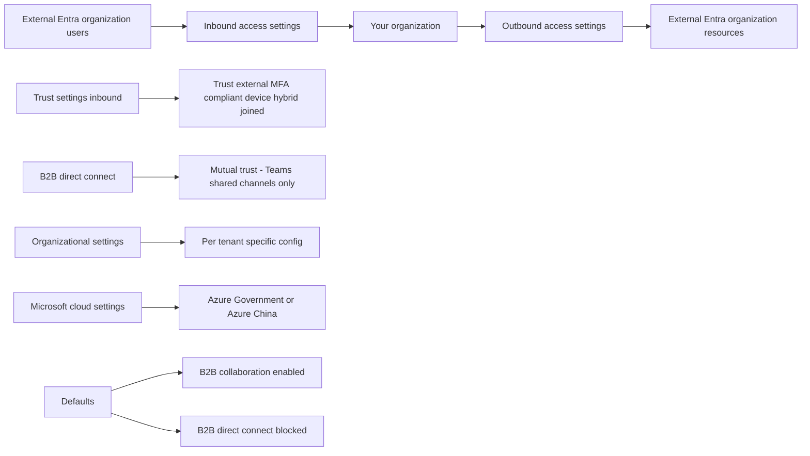
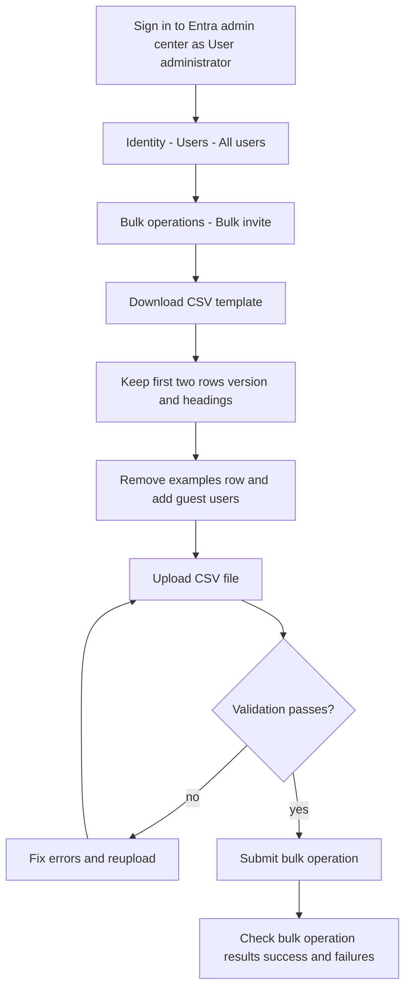
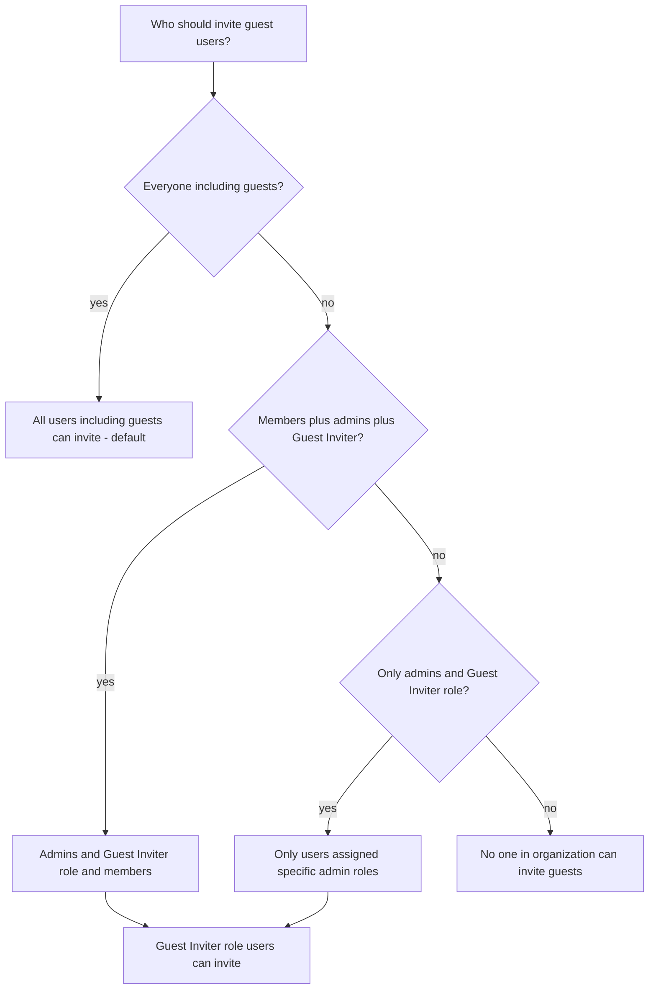

# Module 03: Describe guest access and Business to Business accounts - Diagrams

Source lessons

- Introduction
- Describe guest access and Business to Business accounts
- Manage external collaboration
- Exercise - configure external collaboration
- Invite external users - individually and in bulk
- Exercise - add guest users to directory
- Exercise - invite guest users bulk
- Demo - manage guest users in Microsoft Entra ID
- Manage external user accounts in Microsoft Entra ID
- Manage external users in Microsoft 365 workloads
- Exercise - explore dynamic groups
- Implement and manage Microsoft Entra Verified ID
- Configure identity providers
- Implement cross-tenant access controls
- Summary and resources

### Diagram 1: Guest sign-in method decision - invitation redemption flow
Useful for exam questions asking which identity provider or authentication method a guest user will use.

### Diagram 2: Choosing the correct external identity feature
Exam-style decision tree mapping a requirement to the correct feature, with B2B collaboration as the common distractor for direct connect scenarios.

### Diagram 3: Cross-tenant access settings architecture
Helps distinguish inbound, outbound, trust settings, and B2B direct connect defaults on cross-tenant access questions.

### Diagram 4: Bulk invite guest users process
Shows the exact portal path and CSV rules frequently tested for bulk invitation questions.

### Diagram 5: Guest invitation permission decision
Decision tree for selecting the correct external collaboration setting or role when restricting who can invite guests.

