# Module 03: Describe guest access and Business to Business accounts - Mind Map

Source lessons

- Introduction
- Describe guest access and Business to Business accounts
- Manage external collaboration
- Exercise - configure external collaboration
- Invite external users - individually and in bulk
- Exercise - add guest users to directory
- Exercise - invite guest users bulk
- Demo - manage guest users in Microsoft Entra ID
- Manage external user accounts in Microsoft Entra ID
- Manage external users in Microsoft 365 workloads
- Exercise - explore dynamic groups
- Implement and manage Microsoft Entra Verified ID
- Configure identity providers
- Implement cross-tenant access controls
- Summary and resources

```mermaid
mindmap
  root((Manage external collaboration and B2B))
    Guest access and B2B basics
      B2B collaboration feature
        Part of External Identities
        Invite guest users securely
        Share apps and resources
      Guest user identity
        UserType set to Guest
        UPN contains #EXT# marker
        User object created in directory
      Self-service sign-up user flows
        Users sign up for apps
        Work school or social identity
    External collaboration settings
      Guest user access levels
        Same access as members
        Limited to properties and memberships
        Restricted to own objects
      Guest invite settings
        Everyone can invite guests
        Member users and admins only
        Specific admin roles only
        No one can invite
      Guest Inviter role
        Assigned users can invite
      Collaboration restrictions
        Allowlist or blocklist domains
        Only one policy per organization
        Policy max 25 KB
        Independent of SharePoint lists
      Portal path
        Identity then External Identities
    Inviting guest users
      Individual invitation
        New user then invite external user
        Invite to directory group or app
        User type shows Guest
        Invitation never expires
        Plus symbols not supported
      Bulk invitation
        Bulk operations then Bulk invite
        Download CSV template
        Keep first two rows unchanged
        Remove examples row
        Upload and validate file
        Review bulk operation results
      Self-service app management
        Admin enables group management
        App owner invites via Access Panel
    Managing guest user accounts
      UserType property
        Member versus Guest
        No relation to sign-in method
      Identities property
        External Microsoft Entra tenant
        Microsoft account
        google.com and facebook.com
        mail one-time passcode
        SAML or WS-Fed issuer URI
      Guest privileges
        Can be added to any role
        Remove default guest limitations
        Use least privilege with PIM
      Convert UserType
        Possible with PowerShell
        Not recommended as atomic activity
      Dynamic groups
        Rules based on user attributes
        Requires Premium P1 or P2
        Rule example objectId not null
    Microsoft 365 external users
      Default collaboration settings
        Authenticated sharing enabled
        Shared channels disabled
        Anonymous meeting join enabled
      Governance tools
        Microsoft 365 admin center
        Microsoft Entra admin center
        Graph PowerShell or CLI
    Identity providers
      SAML and WS-Fed federation
        Formerly direct federation
        Tied to domain namespaces
        Only affects new invitations
        Deleting federation blocks sign-in
      SAML 2.0 requirements
        AssertionConsumerService endpoint
        Audience tenant based endpoint
        Issuer URI of partner IdP
        Claims NameID persistent and emailaddress
      WS-Fed requirements
        PassiveRequestorEndpoint
        Claims ImmutableID and emailaddress
        AD FS and Shibboleth tested
      Google federation
        For Gmail users only
        Create Google developer project
        Configure client ID and secret
        All identity providers portal
        Deleting blocks redeemed users
        WebView sign-in deprecated
      Facebook federation
        Self-service sign-up only
        Cannot redeem invitations
        App ID and App Secret
    Cross-tenant access settings
      Inbound access settings
        Control external users coming in
      Outbound access settings
        Control user access to external orgs
      Trust settings
        Trust MFA claims
        Compliant and hybrid joined device
      B2B direct connect
        Mutual trust required both sides
        Works with Teams shared channels
      Organizational and cloud settings
        Per organization configurations
        Microsoft cloud settings
    Microsoft Entra Verified ID
      Verifiable credentials
        Claims from issuer about subject
        Free REST API for verifiers
      Deployment prerequisites
        Azure tenant with subscription
        Premium license required
        Global administrator login
        Azure Key Vault configured
      Setup steps
        Search Verifiable Credentials
        Provide organization name and domain
        Bind DID to domain
```

