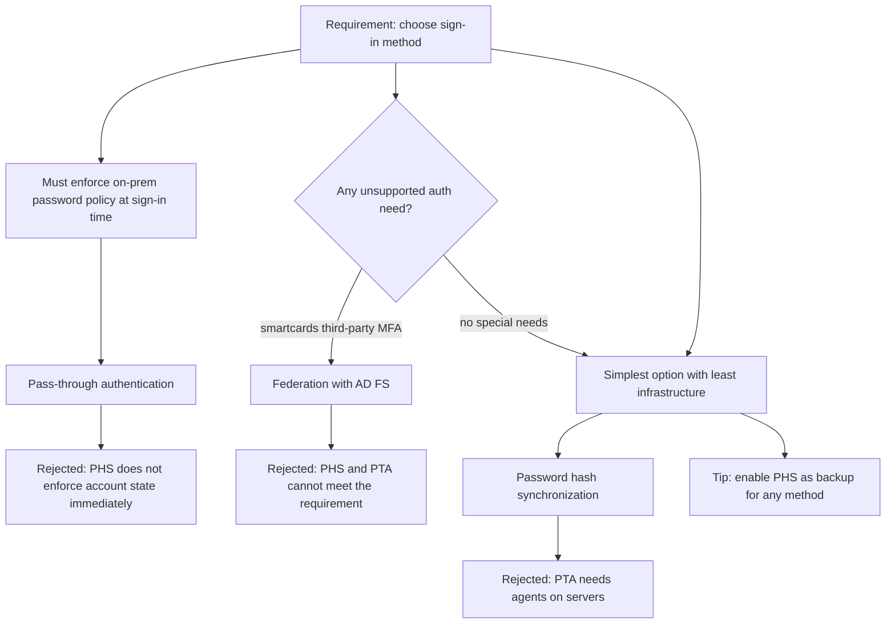
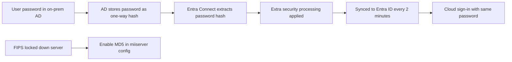
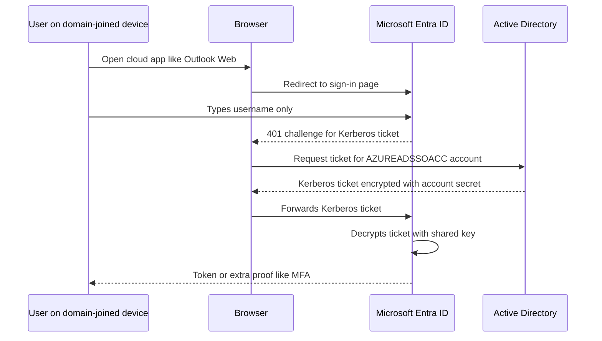
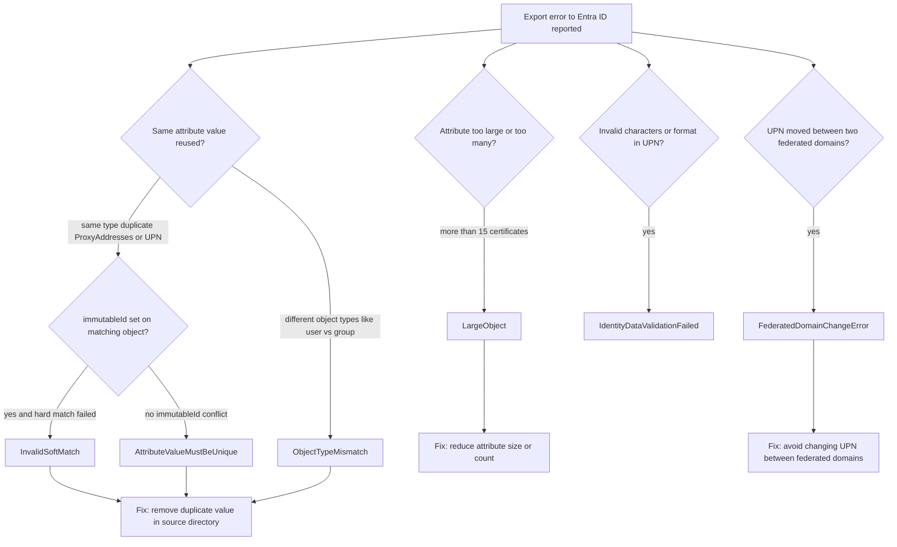
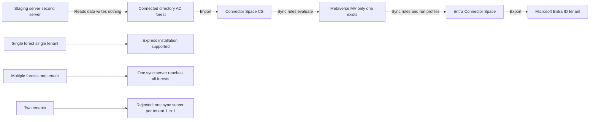
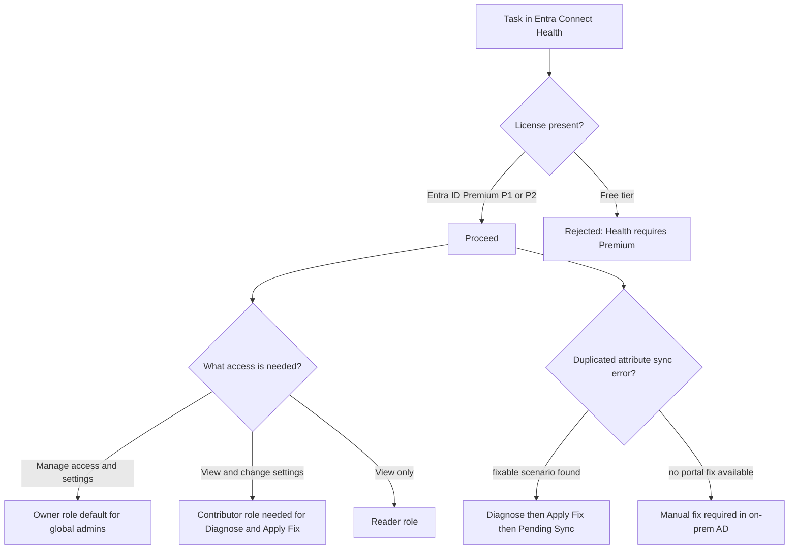

# Module 04: Plan, design, and implement Microsoft Entra Connect - Diagrams

Source lessons

- Introduction
- Plan, design, and implement Microsoft Entra Connect
- Implement manage password hash synchronization (PHS)
- Implement manage pass-through authentication (PTA)
- Explore pass-through authentication and seamless single sign-on (SSO)
- Implement and manage federation
- Trouble-shoot synchronization errors
- Implement Microsoft Entra Connect Health
- Manage Microsoft Entra Health
- Summary and resources

### Authentication method decision path
Use this to quickly answer SC-300 questions that give a requirement and ask which sign-in method to choose, including the common distractors.

### Password hash synchronization flow
Use this to recall how the hash of the hash travels and that the sync runs every two minutes.

### Seamless SSO browser sign-in sequence
Use this to answer questions about the Kerberos flow and the AZUREADSSOACC computer account.

### Sync error troubleshooting decision tree
Use this to map a described error scenario to the correct error name and fix, while avoiding the distractor errors.

### Entra Connect sync architecture and topologies
Use this to remember the staging areas, the single metaverse, and which topologies are supported versus the distractor options.

### Connect Health access and diagnose decision path
Use this for questions about required licenses, RBAC roles, and the duplicated attribute self-service fix workflow.

