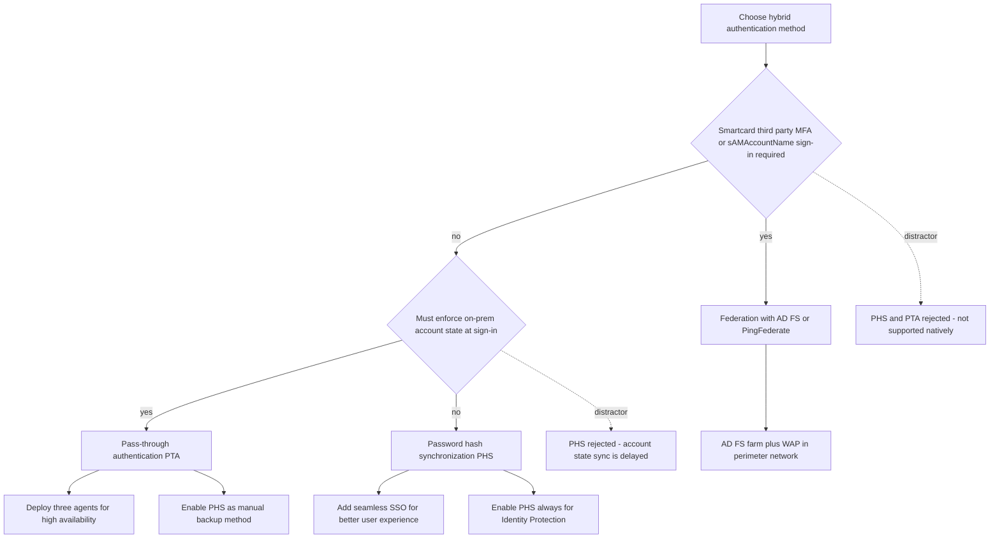
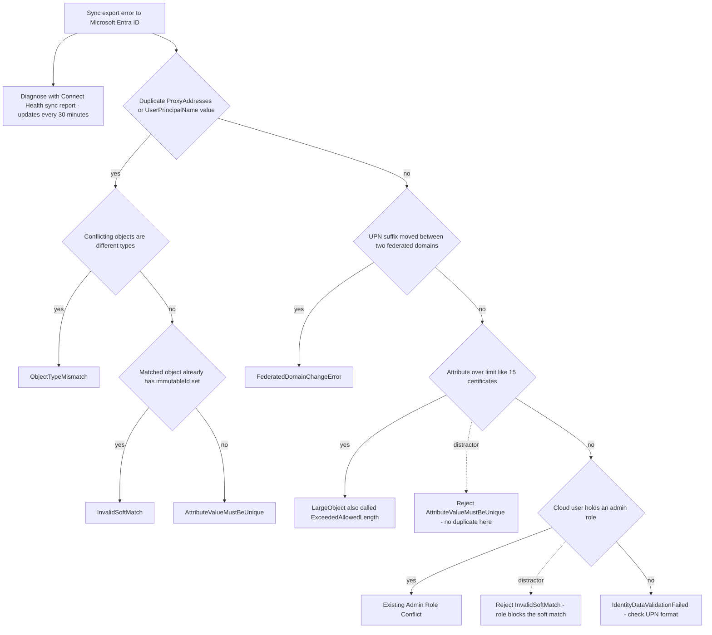
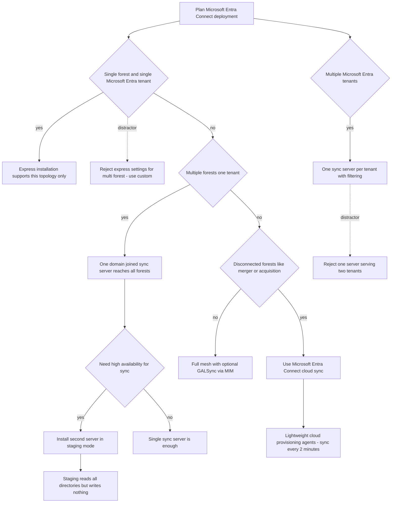
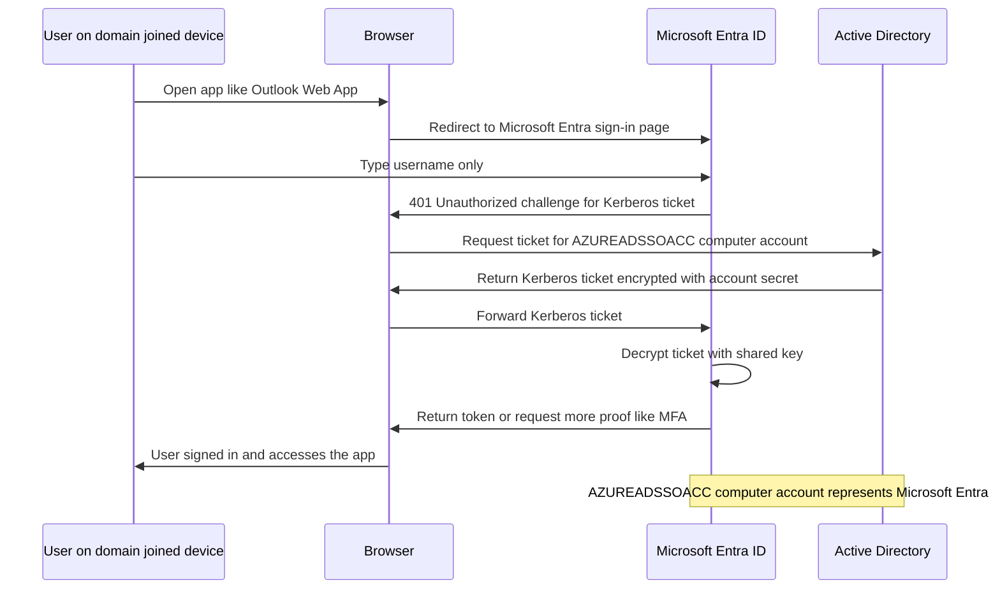
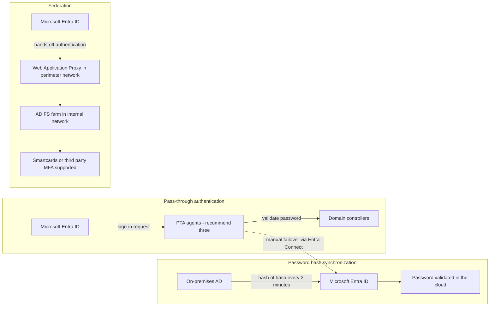

# Module 04: Plan, design, and implement Microsoft Entra Connect - Diagrams (part 1)

Source lessons

- Introduction
- Plan, design, and implement Microsoft Entra Connect
- Implement manage password hash synchronization (PHS)
- Implement manage pass-through authentication (PTA)
- Explore pass-through authentication and seamless single sign-on (SSO)
- Implement and manage federation
- Trouble-shoot synchronization errors
- Implement Microsoft Entra Connect Health

### Choose the hybrid authentication method
Use this when an exam question describes authentication requirements and you must pick between PHS, PTA and federation while avoiding the classic distractors.

### Troubleshoot synchronization errors by symptom
Use this to map the symptom described in a troubleshooting question to the exact sync error name the exam expects.

### Select the sync topology or tool
Use this for questions asking which installation type, topology or sync tool fits a described on-premises environment.

### Seamless SSO browser sign-in flow
Use this to remember the Kerberos flow and the AZUREADSSOACC computer account, a frequent exam detail.

### Where password validation happens per method
Use this to compare the three sign-in methods and recall where validation occurs and which components are required on-premises.

