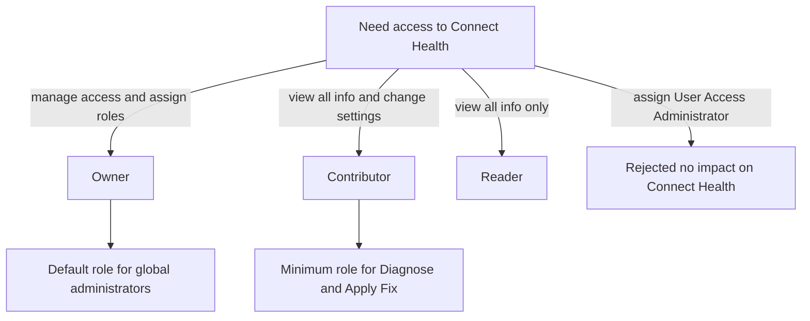
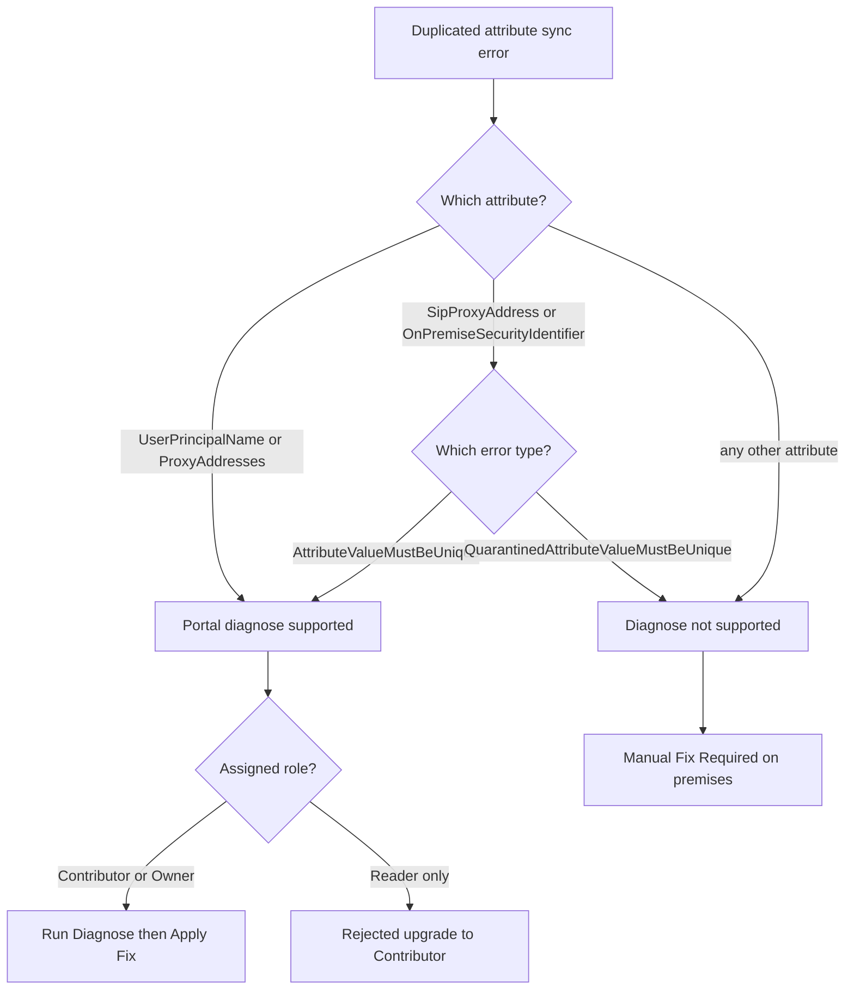
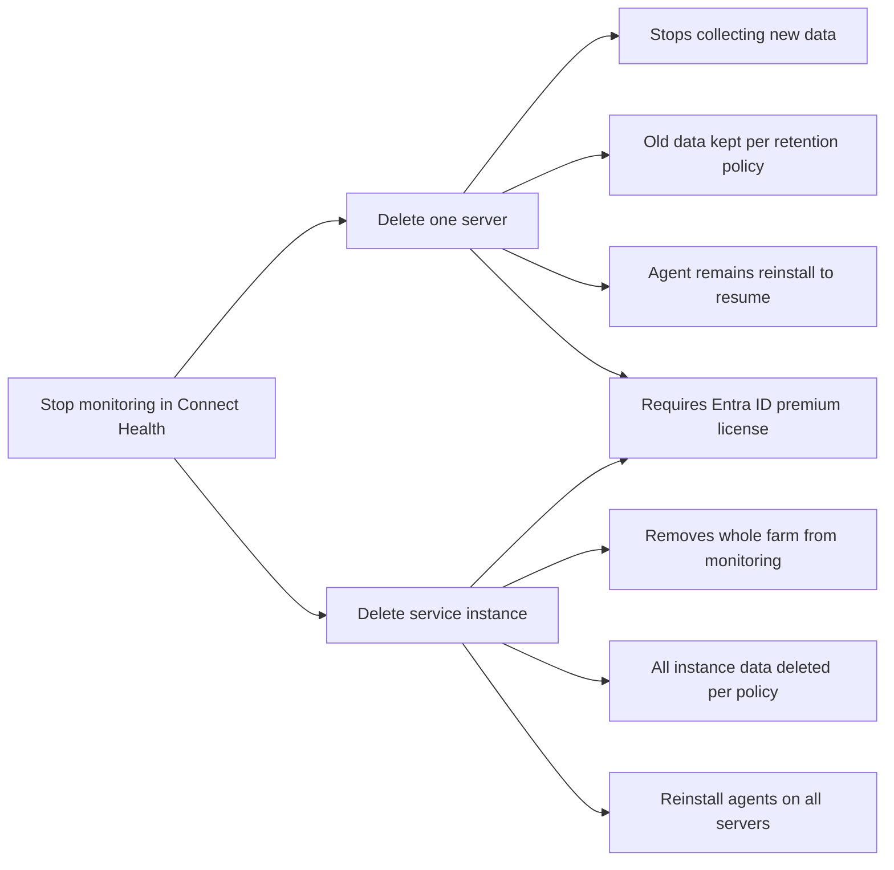
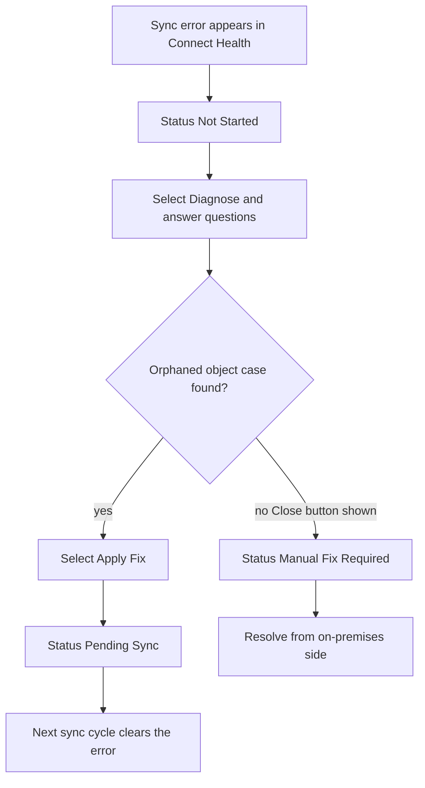
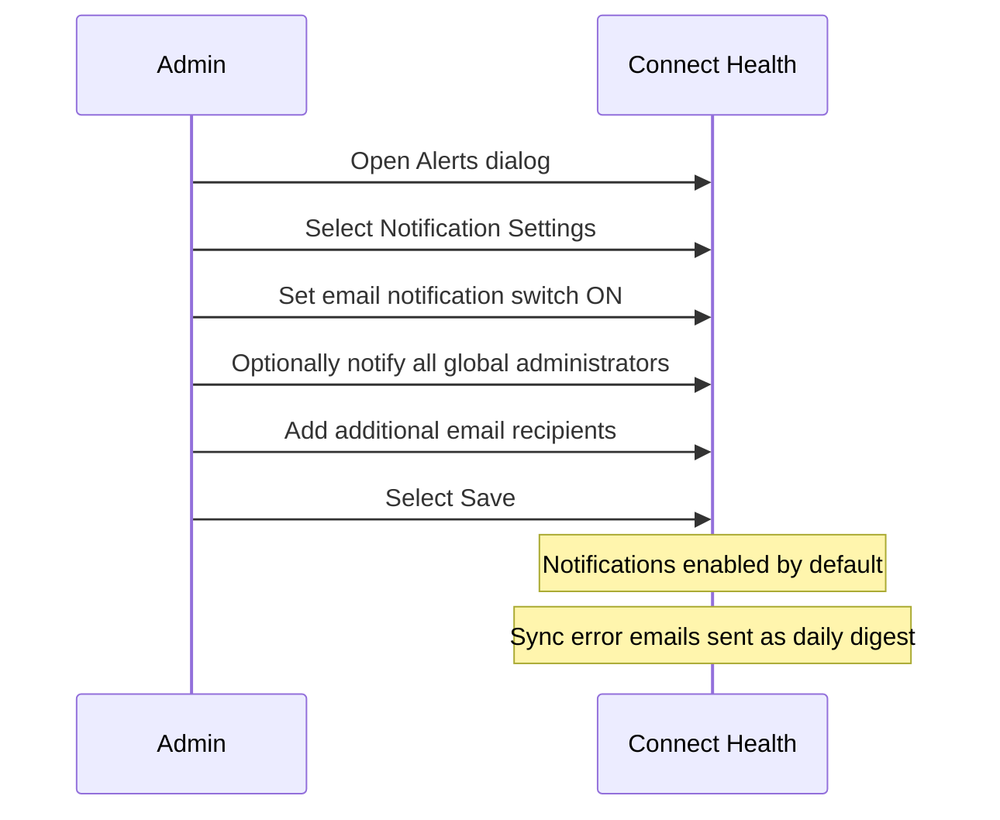

# Module 04: Plan, design, and implement Microsoft Entra Connect - Diagrams (part 2)

Source lessons

- Manage Microsoft Entra Health
- Summary and resources

### RBAC role selection for Microsoft Entra Connect Health
Useful when a question asks which built-in role grants a specific level of access, including the trap that other Azure roles have no impact.

### Duplicated attribute sync error fixability decision
Helps you decide whether a duplicated attribute sync error can be fixed from the portal or requires manual on-premises remediation, a common scenario question.

### Delete server versus delete service instance
Useful for comparing the effects of deleting a server versus a service instance, including the premium license requirement and Health Agent behavior.

### Sync error remediation workflow and statuses
Maps the diagnose status lifecycle so you can predict which status appears after each action in remediation questions.

### Email notification configuration steps
Summarizes the exact portal steps and default behavior of email notifications, which is testable as an ordering or true or false item.

