# Module 04: Plan, design, and implement Microsoft Entra Connect - Mind Map

Source lessons

- Introduction
- Plan, design, and implement Microsoft Entra Connect
- Implement manage password hash synchronization (PHS)
- Implement manage pass-through authentication (PTA)
- Explore pass-through authentication and seamless single sign-on (SSO)
- Implement and manage federation
- Trouble-shoot synchronization errors
- Implement Microsoft Entra Connect Health
- Manage Microsoft Entra Health
- Summary and resources

```mermaid
mindmap
  root((Implement and Manage Hybrid Identity))
    Introduction
      Hybrid identity spans on-premises and cloud
      Unified authentication and authorization
      Extend AD to Microsoft Entra ID
      Learning objectives
        Plan and implement Entra Connect
        Implement PHS and PTA
        Implement seamless SSO
        Manage federation excluding manual AD FS
        Troubleshoot sync errors
        Implement Connect Health
    Entra Connect Design
      Capabilities
        Synchronization of users and groups
        Password hash synchronization
        Pass-through authentication
        Federation integration
        Health monitoring
      Design concepts
        sourceAnchor immutable attribute
        Also called immutableId
        Max 60 characters length
        objectGuid recommended for single forest
        EmployeeID as stable alternative
      Sign-in with UPN
        UPN suffix must match verified domain
        Non-routable domains need custom install
        contoso.local not verifiable
      Topologies
        Single forest single tenant
        Multiple forests single tenant
        Full mesh with optional GALSync
        Account-resource forest
        One sync server per tenant
        Staging server for standby
    Authentication Methods
      Cloud authentication
        Entra ID handles sign-in
        Works with seamless SSO
      Password hash synchronization
        Simplest method least effort
        Sync runs every 2 minutes
        Hash of the hash only
        Cannot change frequency
        Initial full sync then selective sync
        Backup method for PTA
        FIPS requires MD5 disabled change
        Recommended second server staging mode
      Pass-through authentication
        Agents validate passwords on-premises
        Recommend three agents deployed
        Agents not supported in perimeter network
        Enforces account state and sign-in hours
        Failover to PHS is manual
      Federated authentication
        Hands off to AD FS or PingFederate
        Smartcard and third-party MFA support
        sAMAccountName sign-in scenarios
        Requires farm in perimeter network
        PingFederate 8.4 or later required
      Recommendations
        Enable PHS with any method
        Survives on-premises outages
        Identity Protection needs P2
        Leaked credentials report
    Seamless SSO
      Combined with PHS or PTA
      Not applicable to AD FS
      Deployed via Group Policy
      No extra on-premises components
      Browser sign-in flow
        401 challenge for Kerberos ticket
        AZUREADSSOACC computer account
        Entra ID decrypts Kerberos ticket
      Native client flow
        WS-Trust MEX endpoint
        SAML token issued to app
        OAuth2 access and refresh tokens
    Federation Management
      Prerequisites
        Local admin on federation servers
        Local admin on workgroup WAP servers
        Windows Remote Management access
      Setup steps
        Specify AD FS servers domain joined
        Specify Web Application Proxy servers
        Perimeter network placement
        Group managed service account
        Federate one domain initially
      Wizard tasks
        Repair the trust
        Alternate sign-in ID setup
        Add federated domain
        Device writeback for conditional access
    Troubleshooting Sync Errors
      Operations
        Import Synchronization Export
        Export errors to Entra ID
      InvalidSoftMatch
        Hard match uses sourceAnchor
        Soft match uses ProxyAddresses and UPN
        Fix duplicate attributes at source
      ObjectTypeMismatch
        Different object types same proxyAddress
        User and group conflict example
      AttributeValueMustBeUnique
        ProxyAddresses and UPN must be unique
        Duplicate attribute resiliency feature
      IdentityDataValidationFailed
        Invalid UPN characters or format
      FederatedDomainChangeError
        UPN suffix change between federated domains
      LargeObject error
        userCertificate limit of 15
        thumbnailPhoto too large
      Admin role conflict
        Remove roles and hard delete
        Restore roles after soft match
      Diagnose tool statuses
        Not Started
        Manual Fix Required
        Pending Sync
    Connect Health
      Licensing and requirements
        Requires Entra ID Premium P1
        Global administrator required
        Agent on each targeted server
        FIPS must be disabled
        Ports 443 and 5671
        Latest agent only needs 443
        PowerShell 4.0 or newer
      Agent types
        AD FS agent on separate server
        Sync agent installed automatically
        Diagnostics Insights Monitoring services
      Sync error reports
        Updated every 30 minutes
        Viewed in Azure portal
    Managing Health
      Email notifications
        Enabled by default
        Daily digest of sync errors
        Additional recipients supported
      Deleting servers or services
        Stops data collection
        Does not uninstall agent
        Reinstall agent to resume monitoring
      Azure RBAC roles
        Owner manages access and settings
        Contributor views and changes settings
        Reader views all information
        Global admins default Owner
        Contributor needed for Diagnose feature
      Access scope
        All service instances recommended
        Individual service instance scope
    Summary
      Implement PHS PTA and seamless SSO
      Manage federation excluding manual AD FS
      Troubleshoot synchronization errors
      Implement and manage Connect Health
```

