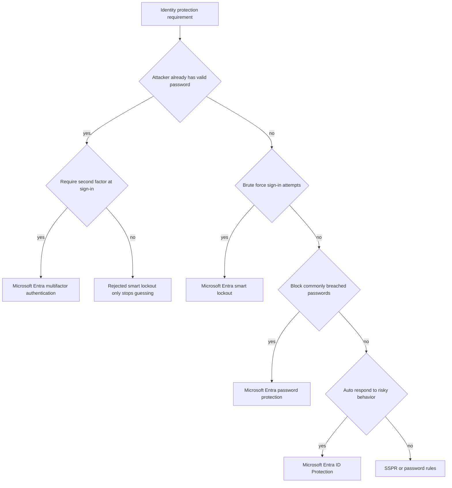
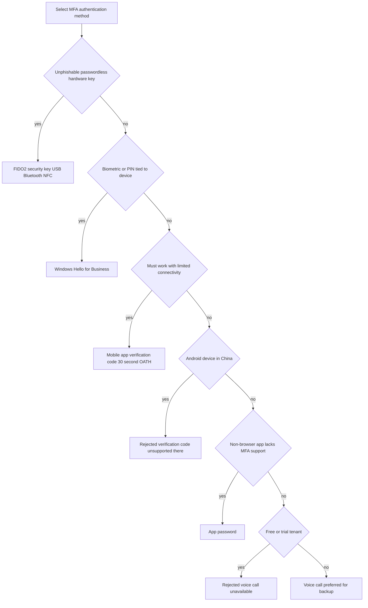
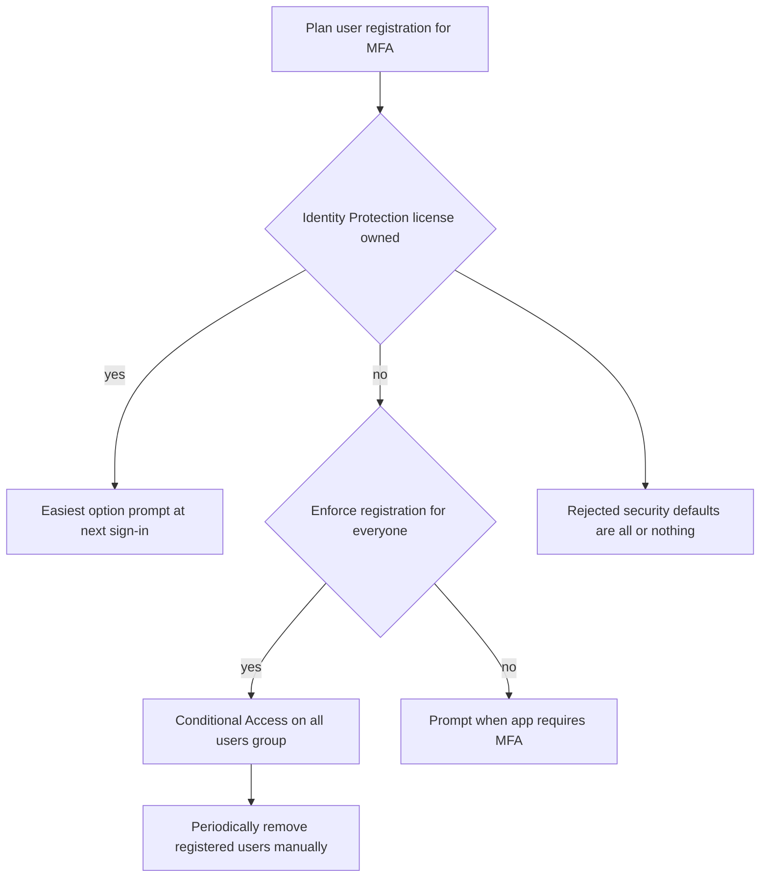
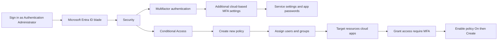
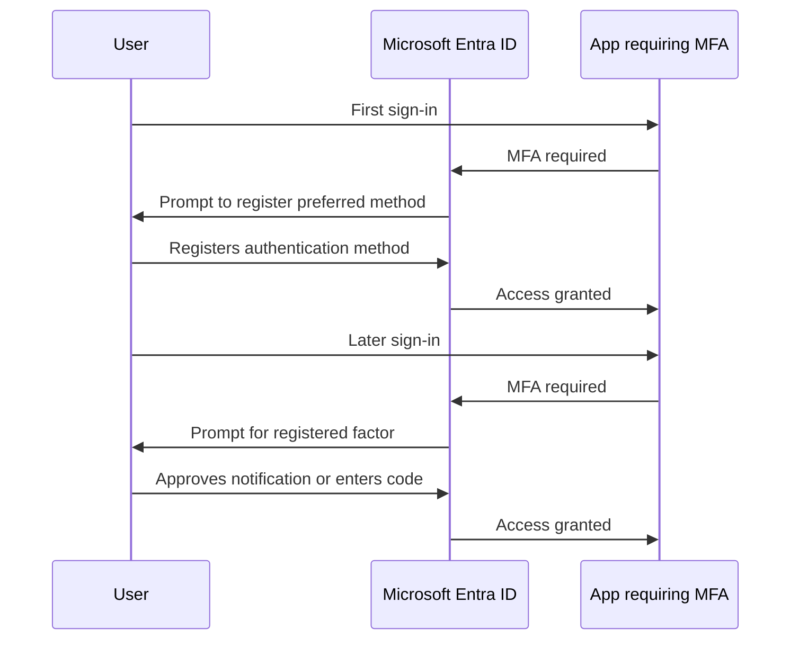

# Module 05: What is Microsoft Entra multifactor authentication - Diagrams

Source lessons

- Introduction
- What is Microsoft Entra multifactor authentication
- Plan your multifactor authentication deployment
- Exercise - Enable Microsoft Entra multifactor authentication
- Configure multifactor authentication methods
- Summary

### Choosing the identity protection feature for a stated requirement
Use this when the exam gives a threat scenario and you must pick between MFA and its look-alike features like Smart Lockout, password protection, SSPR and ID Protection.

### Selecting the MFA authentication method
Use this to match method requirements to features, including the FIDO2 versus Windows Hello distractor and the free-tier voice call limitation.

### Deciding how users register for MFA
Use this when the exam asks for the easiest or the most automated registration approach and which license each option requires.

### Portal path to configure MFA settings and a Conditional Access policy
Use this to memorize the exact blade navigation and the required role for the enable MFA exercise.

### First sign-in registration versus later MFA sign-ins
Use this to recall the user experience flow tested in scenario questions about first-time registration prompts and repeat prompts.

