# Module 05: What is Microsoft Entra multifactor authentication - Mind Map

Source lessons

- Introduction
- What is Microsoft Entra multifactor authentication
- Plan your multifactor authentication deployment
- Exercise - Enable Microsoft Entra multifactor authentication
- Configure multifactor authentication methods
- Summary

```mermaid
mindmap
  root((Microsoft Entra MFA))
    Introduction
      Scenario
        Protect confidential client designs
        User accounts are the weak point
      Learning objectives
        Learn Entra multifactor authentication
        Plan MFA deployment
        Enable MFA for users and apps
      Prerequisites
        Basic Azure portal knowledge
        Basic Microsoft Entra ID knowledge
    What is MFA
      Password risk mitigation
        Password complexity rules
        Password expiration rules
        Self-service password reset SSPR
        Entra ID Protection risk policies
        Entra password protection banned list
        Entra smart lockout
        Entra application proxy
        Single sign-on SSO
        Entra Connect hybrid sync
      Three authentication categories
        Something you know
        Something you possess
        Something you are biometric
      Key exam points
        Requires two or more elements
        Most effective way to stop sign-in
        Layered approach defeats stolen passwords
    Licensing and entitlement
      Microsoft Entra ID P1 or P2
      Microsoft 365 Business
        Uses security defaults
      Entra ID Free
        Security defaults for all users
      Standalone Microsoft 365 licenses
    Plan the deployment
      Rollout in waves
        Start with pilot users
        Identify setup issues
        Broaden group over time
      Communication plan
        Registration requirements
        Important dates for users
        Microsoft communication templates
      Conditional Access policies
        IF user accesses resource
        THEN complete an action
        Common trigger scenarios
          Specific cloud application
          Specific network access
          Specific client application
          Registering a new device
      Registration enforcement options
        Entra ID Protection prompt
        Prompt on app access
        Conditional Access policy on group
        Manual group review needed
    Authentication methods
      Mobile app verification code
        OATH code every 30 seconds
        Works with limited connectivity
        Not on Android in China
      Mobile app push notification
        Microsoft Authenticator approval
      Call to phone
        Approve using keypad
        Preferred for backups
      FIDO2 security key
        Unphishable passwordless standard
        USB Bluetooth or NFC
      Windows Hello for Business
        Biometric or PIN on device
      OATH tokens
        Software or hardware tokens
    Configure methods details
      Password
        Only method you cannot disable
      Security questions
        SSPR only non-admin accounts
        35 predefined localized questions
        Max 200 characters custom
        Admin cannot read answers
      Email address
        SSPR only
      Microsoft Authenticator app
        Android and iOS supported
        Push notification approve or deny
        Software OATH token codes
      OATH hardware tokens
        OATH-TOTP SHA-1 supported
        30 or 60 second types
        Secret key max 128 characters
      App passwords
        For non-browser apps
        Enabled in service settings
      Voice call limitation
        Not available free or trial tier
    Enable MFA exercise
      Portal path
        Sign in as Authentication Administrator
        Entra ID then Security
        Manage Multifactor authentication
        Additional cloud-based settings
      Create Conditional Access policy
        Name the policy
        Include users and groups
        Target cloud apps
        Conditions any location
        Grant access require MFA
        Enable policy then Create
    Monitoring and summary
      Usage and insights view
        Under Monitoring section
        Registration success and failure
        Last 30 days audit logs
        Drill down per user
      Summary takeaways
        Protect specific apps with policy
        Combine with ID Protection
        Combine with smart lockout
```

