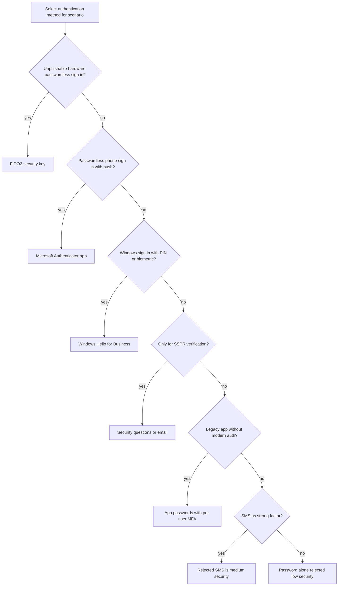
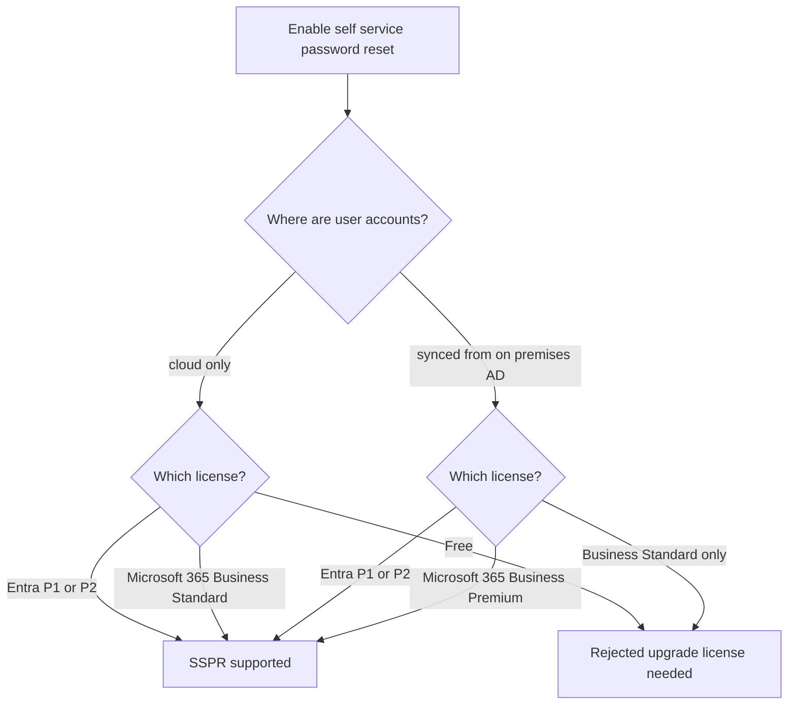
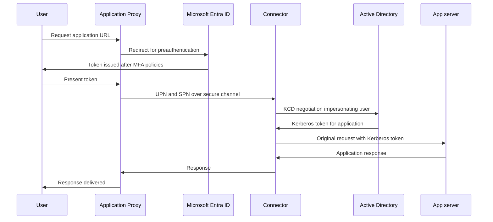
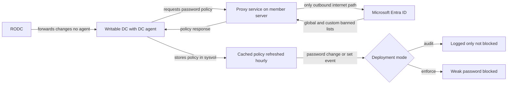
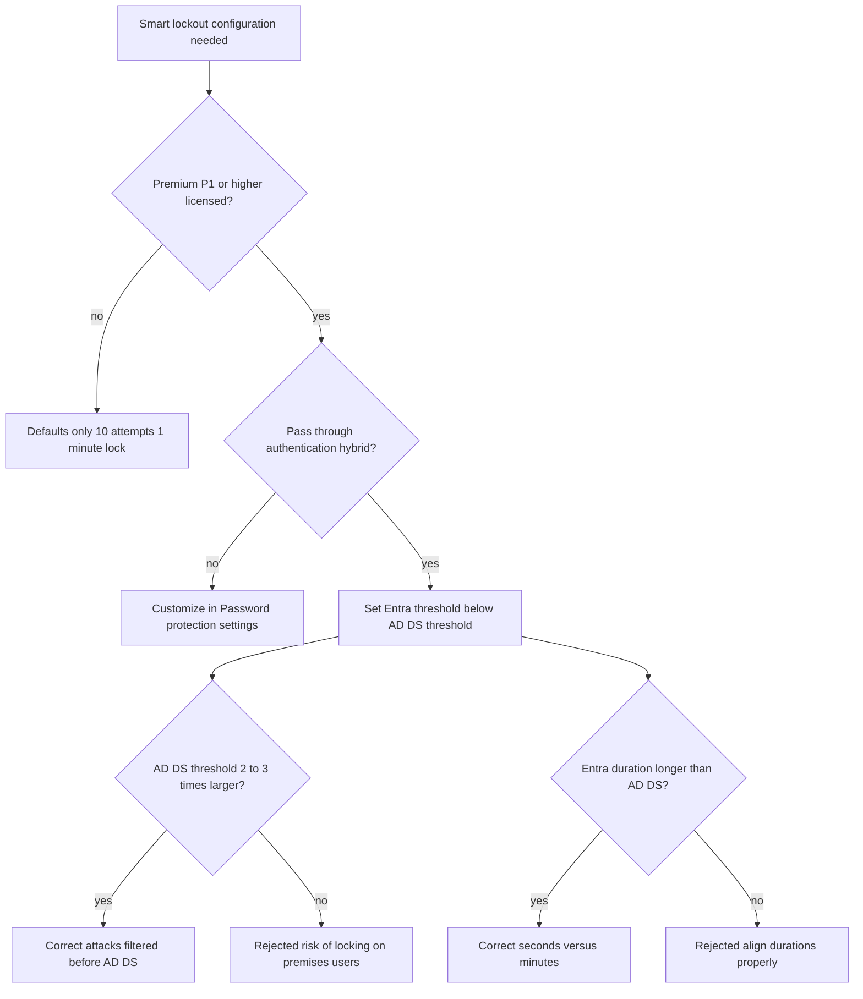

# Module 06: Administer FIDO2 and passwordless authentication methods - Diagrams

Source lessons

- Introduction
- Administer FIDO2 and passwordless authentication methods
- Explore Authenticator app and OATH tokens
- Implement an authentication solution based on Windows Hello for Business
- Exercise configure and deploy self-service password reset
- Deploy and manage password protection
- Configure smart lockout thresholds
- Exercise - Manage Microsoft Entra smart lockout values
- Implement Kerberos and certificate-based authentication in Microsoft Entra ID
- Configure Microsoft Entra user authentication for virtual machines
- Summary and resources

### Decision tree: Choosing the right authentication method
Use this to map exam requirements like unphishable or passwordless to the correct method while spotting the classic SMS and password-only distractors.

### Decision tree: SSPR licensing requirements
Use this to recall the exact license tiers that unlock SSPR for cloud-only versus on-premises accounts, a frequent licensing trap on the exam.

### Sequence diagram: Kerberos Constrained Delegation via Application Proxy
Use this to memorize the exact order of the KCD flow, which is tested in Application Proxy single sign-on questions.

### Architecture: Microsoft Entra Password Protection on-premises components
Use this to remember that the proxy service is the only outbound internet path, that policies cache in sysvol, and how audit versus enforce mode behaves.

### Decision tree: Smart lockout configuration for hybrid deployments
Use this to recall the threshold and duration rules for pass-through authentication scenarios and the P1 licensing requirement for customization.

