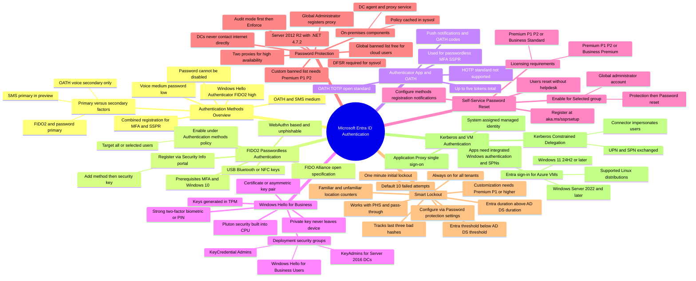

# Module 06: Administer FIDO2 and passwordless authentication methods - Mind Map

Source lessons

- Introduction
- Administer FIDO2 and passwordless authentication methods
- Explore Authenticator app and OATH tokens
- Implement an authentication solution based on Windows Hello for Business
- Exercise configure and deploy self-service password reset
- Deploy and manage password protection
- Configure smart lockout thresholds
- Exercise - Manage Microsoft Entra smart lockout values
- Implement Kerberos and certificate-based authentication in Microsoft Entra ID
- Configure Microsoft Entra user authentication for virtual machines
- Summary and resources

