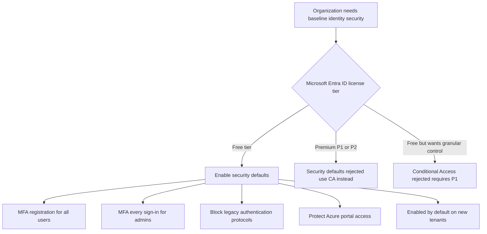
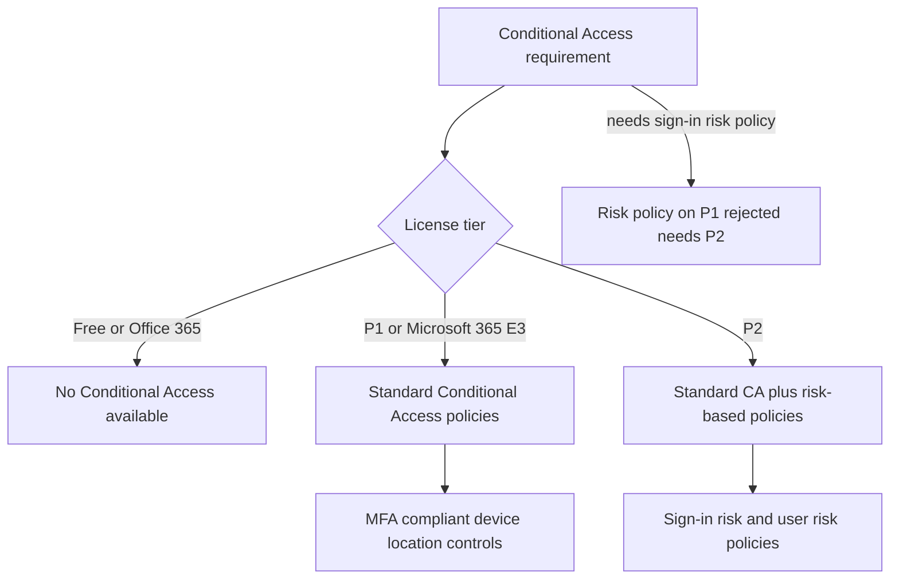
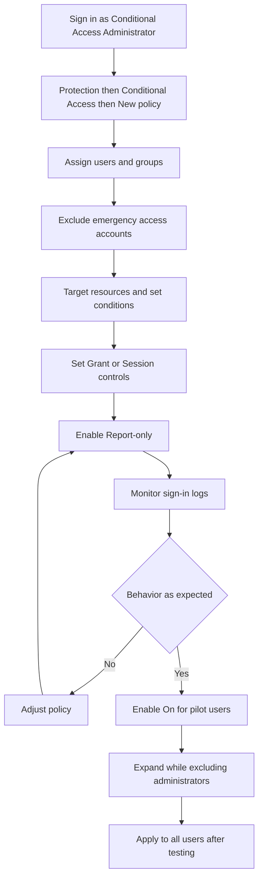
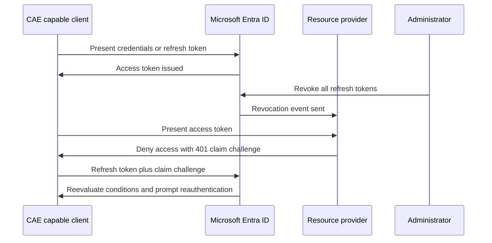
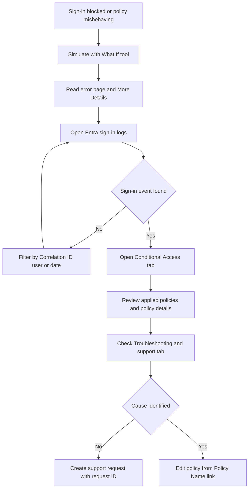

# Module 07: Plan security defaults - Diagrams

Source lessons

- Introduction
- Plan security defaults
- Exercise - Work with security defaults
- Plan Conditional Access policies
- Implement Conditional Access policy controls and assignments
- Exercise - Implement Conditional Access policies roles and assignments
- Test and troubleshoot Conditional Access policies
- Implement application controls
- Implement session management and continuous access evaluation
- Exercise - Configure authentication session controls
- Microsoft Entra Conditional Access Optimization agent
- Summary and resources

### Decision tree - Security defaults or Conditional Access
Use this to answer exam questions asking which baseline protection fits a given organization and license tier.

### Decision tree - License tier and Conditional Access capability
Use this to match a required capability such as risk-based policies to the correct license and reject the common wrong-tier distractor.

### Process - Create and roll out a Conditional Access policy
Use this to recall the exact portal path, required exclusions, and the report-only phased rollout order tested on the exam.

### Sequence - Continuous Access Evaluation revocation flow
Use this to explain how CAE near-real-time revocation works instead of waiting for token expiry.

### Decision tree - Troubleshoot a Conditional Access sign-in block
Use this to order the troubleshooting tools and log tabs correctly when a scenario describes a blocked sign-in.

