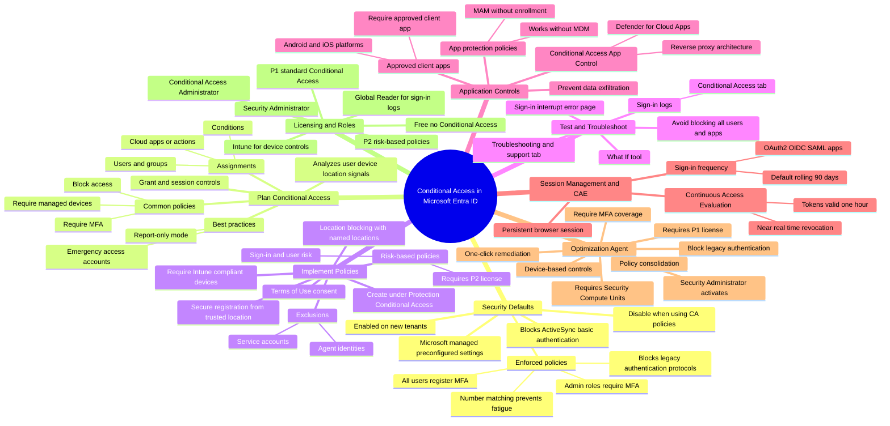

# Module 07: Plan security defaults - Mind Map

Source lessons

- Introduction
- Plan security defaults
- Exercise - Work with security defaults
- Plan Conditional Access policies
- Implement Conditional Access policy controls and assignments
- Exercise - Implement Conditional Access policies roles and assignments
- Test and troubleshoot Conditional Access policies
- Implement application controls
- Implement session management and continuous access evaluation
- Exercise - Configure authentication session controls
- Microsoft Entra Conditional Access Optimization agent
- Summary and resources

