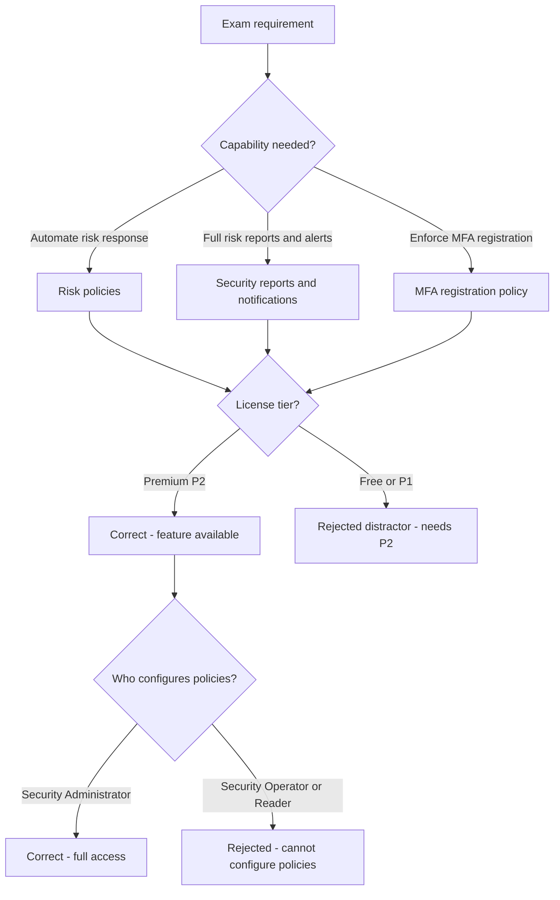
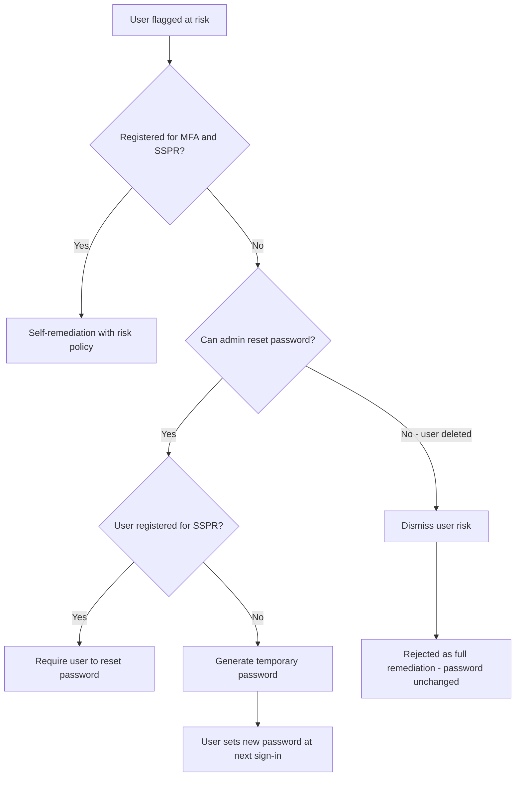
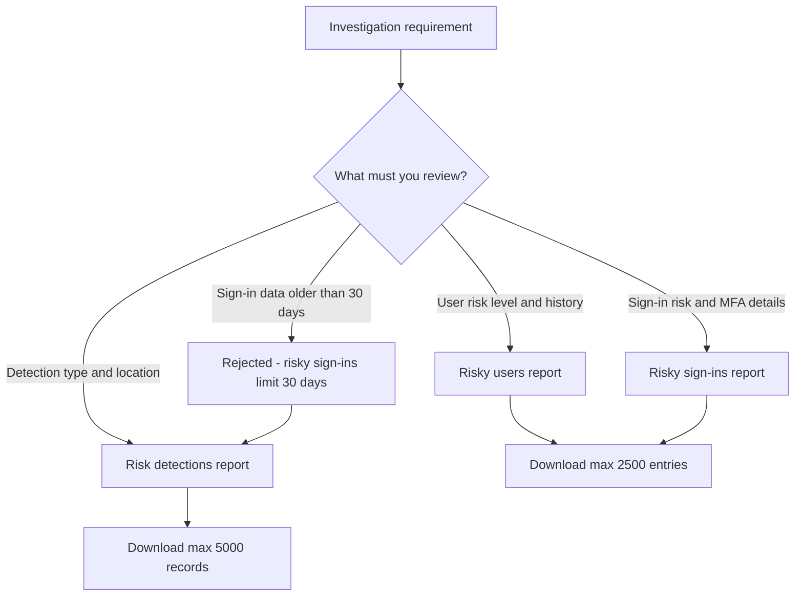
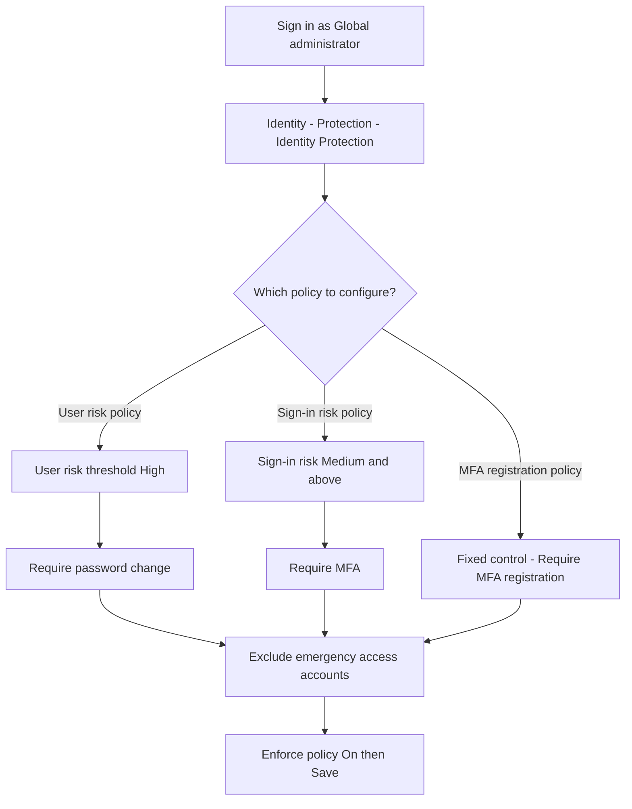
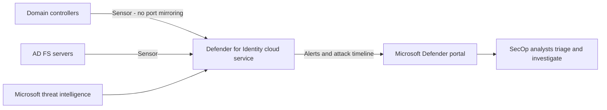

# Module 08: Review identity protection basics - Diagrams

Source lessons

- Introduction
- Review identity protection basics
- Implement and manage user risk policy
- Exercise enable sign-in risk policy
- Exercise configure Microsoft Entra multifactor authentication registration polic
- Monitor, investigate, and remediate elevated risky users
- Implement security for workload identities
- Explore Microsoft Defender for Identity
- Explore the Identity Risk Management Agent
- Summary and resources

### Identity Protection capability and license decision tree
Use this to answer classic SC-300 license-tier questions by matching the required capability to Microsoft Entra ID Premium P2 and eliminating the Free or P1 distractor.

### Remediation decision path for a risky user
Use this to pick the correct remediation or unblocking action in scenario questions, with dismiss user risk exposed as the distractor that does not secure the account.

### Choosing the correct Identity Protection report
Use this to match an investigation requirement to the risky users, risky sign-ins, or risk detections report and recall the 30 day, 90 day and download limits.

### Configuring the three Identity Protection policies
Use this to recall the exact portal path and the recommended thresholds and access controls for the user risk, sign-in risk, and MFA registration policies.

### Defender for Identity architecture and data flow
Use this to match Defender for Identity components to their functions, a common component-to-purpose matching question on the exam.

