# Module 08: Review identity protection basics - Mind Map

Source lessons

- Introduction
- Review identity protection basics
- Implement and manage user risk policy
- Exercise enable sign-in risk policy
- Exercise configure Microsoft Entra multifactor authentication registration polic
- Monitor, investigate, and remediate elevated risky users
- Implement security for workload identities
- Explore Microsoft Defender for Identity
- Explore the Identity Risk Management Agent
- Summary and resources

```mermaid
mindmap
  root((Identity Protection))
    Introduction
      Learning objectives
        Review Identity Protection basics
        Implement user risk policy
        Implement sign-in risk policies
        Implement MFA registration policy
        Monitor and remediate risky users
        Explore Defender for Identity
    Identity Protection Basics
      Key tasks
        Automate detection and remediation
        Investigate risks in portal
        Export risk data to third parties
      Signals analyzed daily
        6.5 trillion signals
      Risk detection types
        Anonymous IP address
        Atypical travel
        Malicious IP address
        Unfamiliar sign-in properties
        Leaked credentials
        Password spray
        Entra threat intelligence
        Anomalous token
        Token issuer anomaly
        Suspicious browser
        Verified threat actor IP
        MDCA detections
          New country
          Suspicious inbox forwarding
      Admin roles
        Security Administrator
          Full access
        Security Operator
          Cannot access risky sign-ins report
        Security Reader
          View only
        Global Reader
        Conditional Access Administrator
      Licensing
        Requires Entra ID Premium P2
        Free tier limited reports
        P1 limited risk detections
        P2 full access and notifications
    Risk Policies
      User risk policy
        Detects compromised account probability
        Recommended threshold High
        Control Require password change
      Sign-in risk policy
        Detects suspicious sign-in activity
        Recommended threshold Medium and above
        Control Require MFA
      MFA registration policy
        Require MFA registration control
        Cannot be changed
      Prerequisites
        Register users for MFA and SSPR
        Combined security information registration
      Exclusions
        Emergency access accounts
        Review exclusions regularly
      Trusted network locations
        Reduce false positives
    Portal Configuration Path
      Entra admin center
        Identity
          Protection
            Identity Protection blade
              User risk policy
              Sign-in risk policy
              MFA registration policy
      Enforce policy On then Save
    Investigate Reports
      Risky users report
        Risk history
        Reset password
        Confirm compromise
        Dismiss user risk
        Block user sign-in
      Risky sign-ins report
        Past 30 days
        Real-time and aggregate risk levels
        Conditional Access policies applied
        Confirm compromised or safe
      Risk detections report
        Past 90 days
        Detection type and location
        Link to MDCA portal
      Download limits
        2500 entries users and sign-ins
        5000 records risk detections
      CSV and JSON export
      AI confirmed sign-in safe
    Remediation and Unblocking
      Self-remediation
        Requires MFA and SSPR registration
      Manual password reset
        Generate temporary password
        Require user reset password
      Dismiss user risk
        Does not secure the identity
      Close detections manually
        Confirm user compromised
        Confirm sign-in safe
      Unblock by user risk
        Reset password
        Exclude user from policy
        Disable policy
      Unblock by sign-in risk
        Sign in from familiar location
        Exclude user from policy
    Microsoft Graph API
      Three APIs
        riskDetection
        riskyUsers
        signIn
      App registration steps
        Retrieve domain name
        Register application
        API permissions
          IdentityRiskEvent.Read.All
          IdentityRiskyUser.Read.All
        Client secret credential
      Query examples
        Offline detections filter
        Users passed MFA driven by policy
    Workload Identities
      Definition
        Application or service principal identity
        Cannot perform MFA
        No formal lifecycle
        Store credentials somewhere
      Requirements
        Entra ID Premium P2
        Security admin or operator or reader
      Detections
        Entra threat intelligence
        Suspicious sign-ins
          Learns baseline in 2 to 60 days
        Unusual credential addition to OAuth app
        Admin confirmed compromised
        Leaked credentials
      Conditional Access for workload identities
        Single-tenant service principals only
        Managed identities out of scope
    Defender for Identity
      Formerly Azure Advanced Threat Protection
      Uses on-premises Active Directory signals
      Components
        Microsoft Defender portal
          security.microsoft.com
        Defender for Identity sensor
          Domain controllers
          AD FS
        Cloud service
          Azure infrastructure
    Identity Risk Management Agent
      Uses Large Language Model
      Prerequisites
        Entra ID P2 license
        Security compute units
        Security Administrator to activate
        Security Reader view only
      Agent steps
        Investigate risky user
        Generate findings and risk summary
        Recommend remediation action
        Answer questions via chat
        Store custom instructions in memory
      Settings
        Triggers
          Continuous every 5 minutes
          Daily trigger
          Manual run
        Scope
          Most recent 100 risky users
          Last 90 days
        Communications
        Memory
      Remediation actions
        Dismiss risk
        Reset password
```

