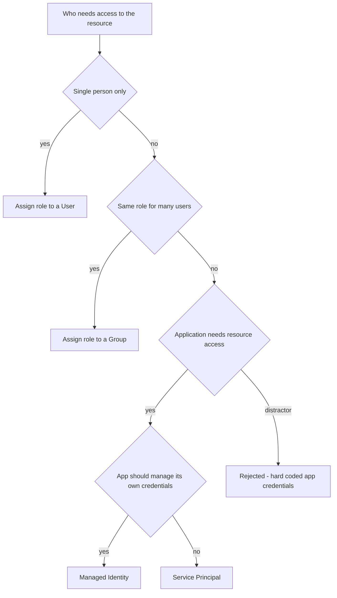
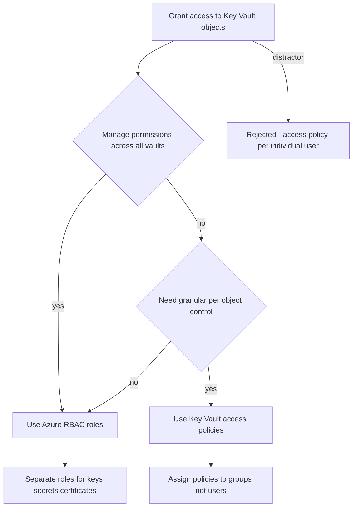
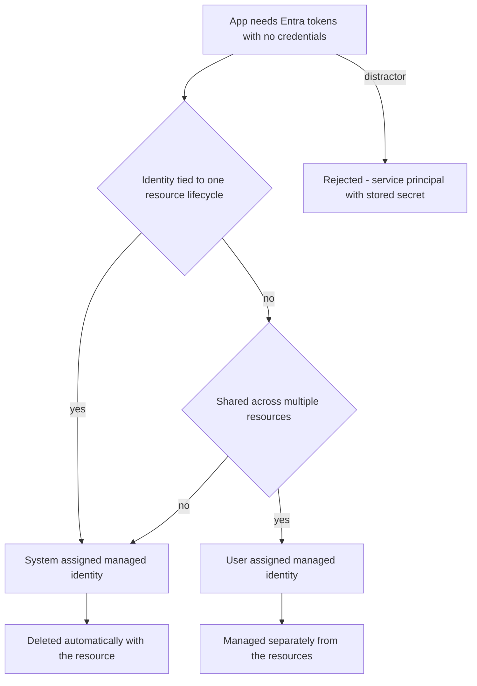
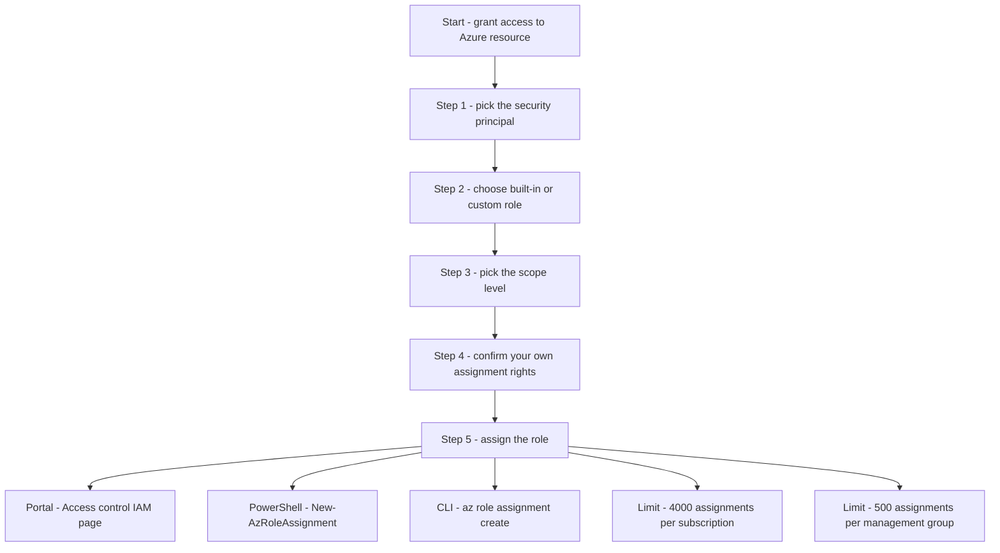
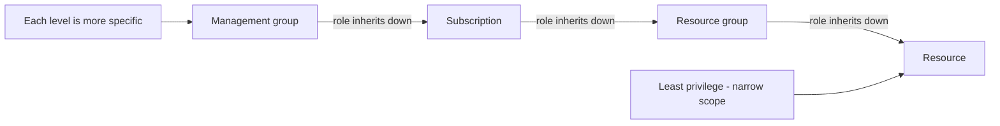

# Module 09: Assign Azure roles - Diagrams

Source lessons

- Introduction
- Assign Azure roles
- Configure custom Azure roles
- Create and configure managed identities
- Access Azure resources with managed identities
- Analyze Azure role permissions
- Configure Azure Key Vault RBAC policies
- Retrieve objects from Azure Key Vault
- Summary and resources

### Decision tree - Choosing the security principal for a role assignment
Useful when an exam question asks which principal should receive an Azure role for a given scenario, including the hard-coded-credentials distractor.

### Decision tree - Key Vault RBAC versus access policies
Useful for questions asking which Key Vault access model fits a requirement, including the trap of assigning policies to individual users.

### Decision tree - System-assigned versus user-assigned managed identity
Useful for distinguishing the two managed identity types by lifecycle and rejecting the service-principal-with-stored-secret distractor.

### Process - The five steps to assign an Azure role
Useful for recalling the ordered role assignment steps, the supported tools, and the assignment limits tested on the exam.

### Architecture - Azure scope hierarchy and inheritance
Useful for visualizing the four scope levels and how lower levels inherit role permissions, a recurring exam topic.

