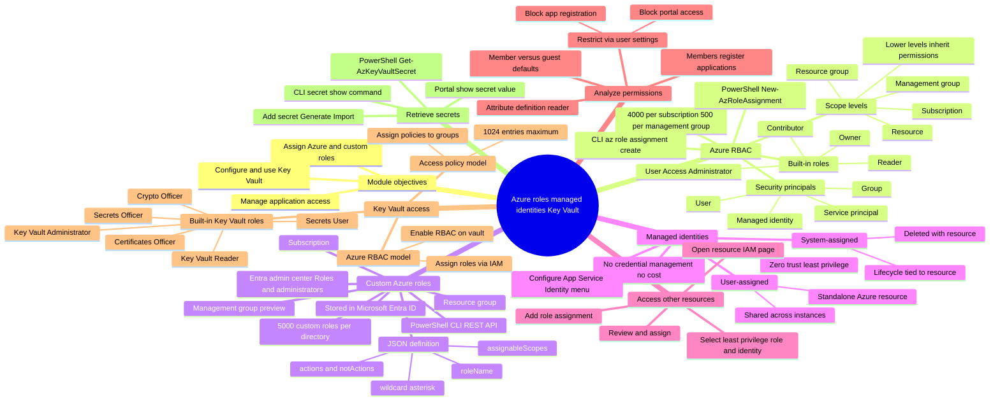

# Module 09: Assign Azure roles - Mind Map

Source lessons

- Introduction
- Assign Azure roles
- Configure custom Azure roles
- Create and configure managed identities
- Access Azure resources with managed identities
- Analyze Azure role permissions
- Configure Azure Key Vault RBAC policies
- Retrieve objects from Azure Key Vault
- Summary and resources

