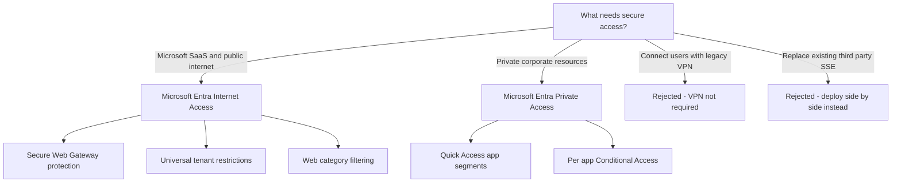
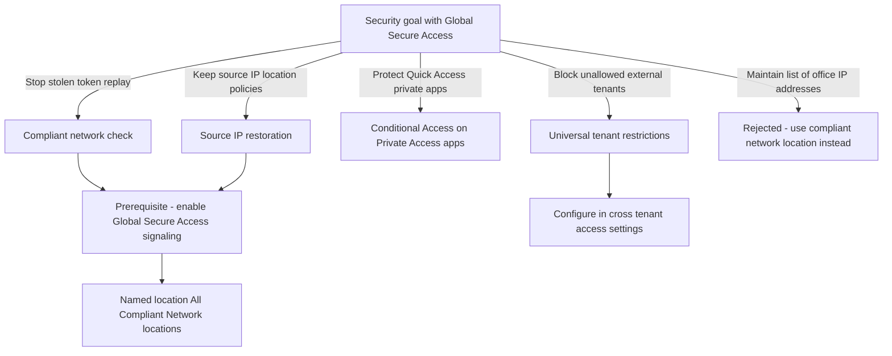
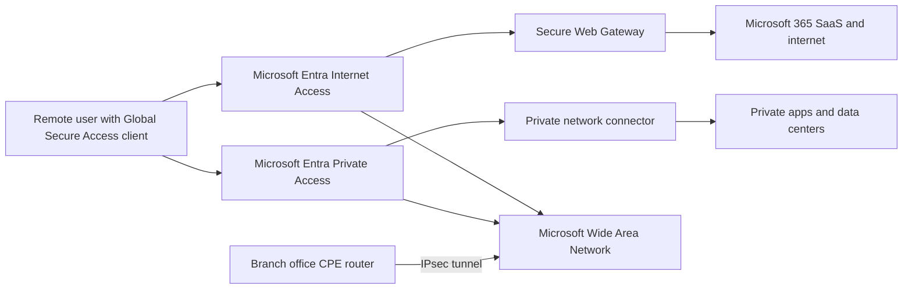
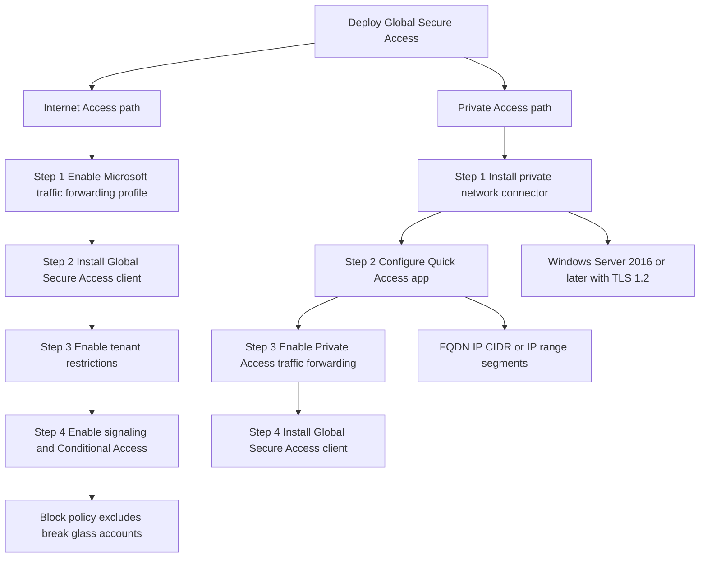
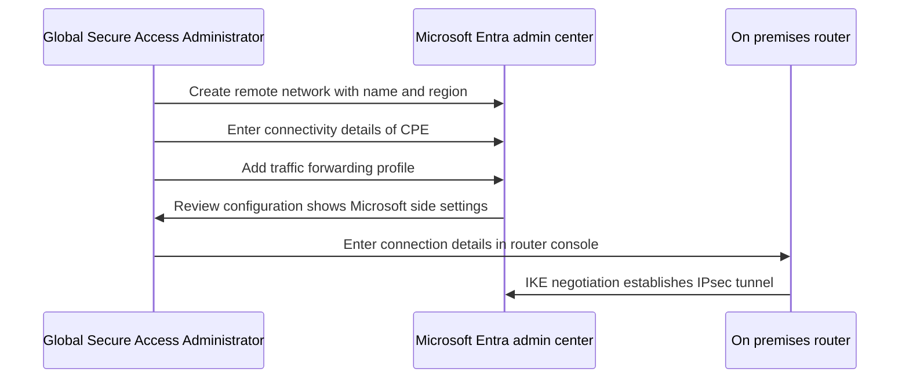

# Module 10: Explore Global Secure Access - Diagrams

Source lessons

- Introduction
- Explore Global Secure Access
- Deploy and configure Microsoft Entra Internet Access
- Deploy and configure Microsoft Entra Private Access
- Explore how to use the Dashboard to drive Global Secure Access
- Create remote networks for use with Global Secure Access
- Use Conditional Access with Global Secure Access
- Explore logs and monitoring options with Global Secure Access
- Summary and resources

### Choosing Between Microsoft Entra Internet Access and Private Access
Use this decision tree to pick the correct Global Secure Access component when an exam question describes a resource type or scenario, including the classic VPN distractor.

### Conditional Access Decision Path with Global Secure Access
Use this to match a Conditional Access requirement to the correct Global Secure Access capability, and to remember the signaling prerequisite.

### Global Secure Access Traffic Flow Architecture
Use this architecture view to answer questions about how client traffic and branch office traffic reach Microsoft, internet, and private resources.

### Deployment Steps for Internet Access and Private Access
Use this side-by-side process map to memorize the four ordered deployment steps of each component and their key configuration details.

### Remote Network Configuration Workflow
Use this sequence to remember that the final remote network step happens on the on-premises router, not in the Microsoft Entra admin center.

