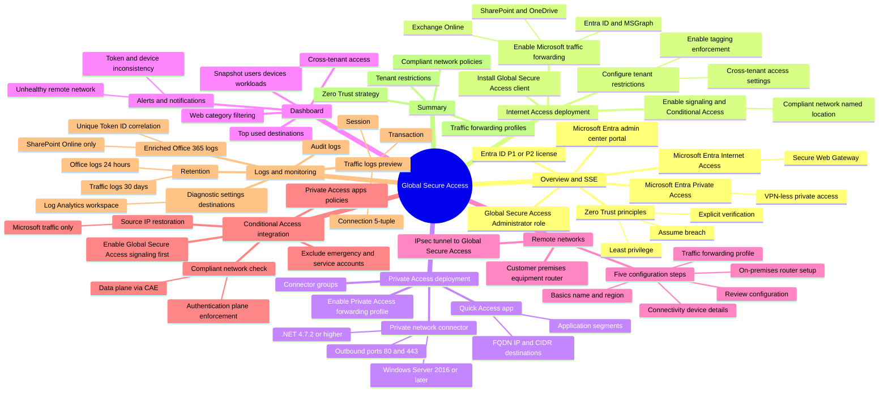

# Module 10: Explore Global Secure Access - Mind Map

Source lessons

- Introduction
- Explore Global Secure Access
- Deploy and configure Microsoft Entra Internet Access
- Deploy and configure Microsoft Entra Private Access
- Explore how to use the Dashboard to drive Global Secure Access
- Create remote networks for use with Global Secure Access
- Use Conditional Access with Global Secure Access
- Explore logs and monitoring options with Global Secure Access
- Summary and resources

