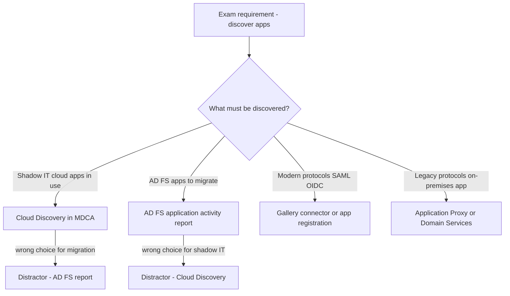
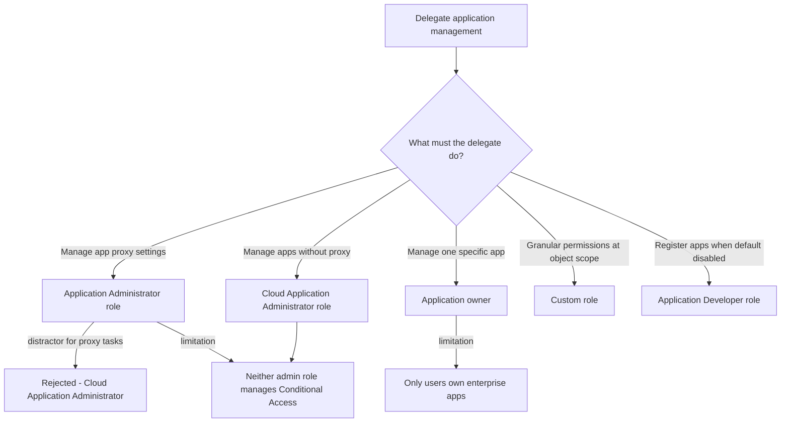
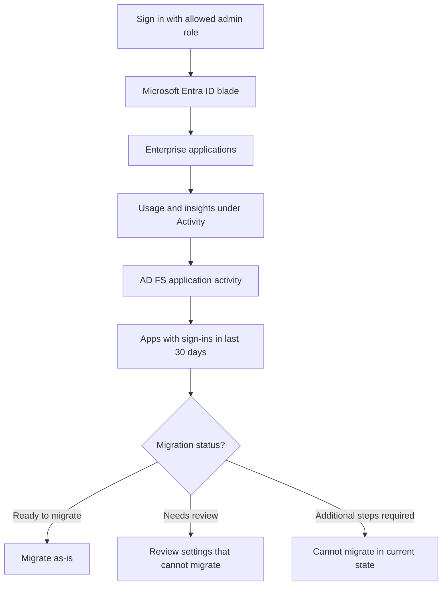

# Module 11: Discover apps by using Microsoft Defender for Cloud Apps and Active Directory Fe - Diagrams

<details><summary>Source lessons</summary>

- Introduction
- Discover apps by using Microsoft Defender for Cloud Apps and Active Directory Fe
- Configure connectors to apps
- Exercise implement access management for apps
- Design and implement app management roles
- Exercise create a custom role to manage app registration
- Configure preintegrated gallery SaaS apps
- Implement and manage policies for OAuth apps
- Summary and resources

</details>

### Diagram 1: Choosing the right app discovery tool
Use this to match a discovery requirement to the correct tool and eliminate the classic distractors that swap Cloud Discovery with the AD FS report.


### Diagram 2: Delegating application management - role selection
Use this to pick the least-privilege role or delegation method in app management scenarios, including the app proxy and Conditional Access gotchas.


### Diagram 3: AD FS application activity report workflow and migration statuses
Use this to recall the exact portal path and the three migration statuses tested in AD FS migration questions.


### Diagram 4: App connector connection flow in Defender for Cloud Apps
Use this to remember the connector scan order and the 12-hour plus real-time data scan cadence.
```mermaid
sequenceDiagram
    participant Admin
    participant MDCA as Defender for Cloud Apps
    participant App as Connected app API
    Admin->>MDCA: Connect app using provider API
    MDCA->>App: Scan and save authentication permissions
    MDCA->>App: Request user list
    App-->>MDCA: Users returned after first scan
    loop Periodic scans
        MDCA->>App: Scan users groups activities files
    end
    MDCA-->>Admin: Activities visible after first full scan
