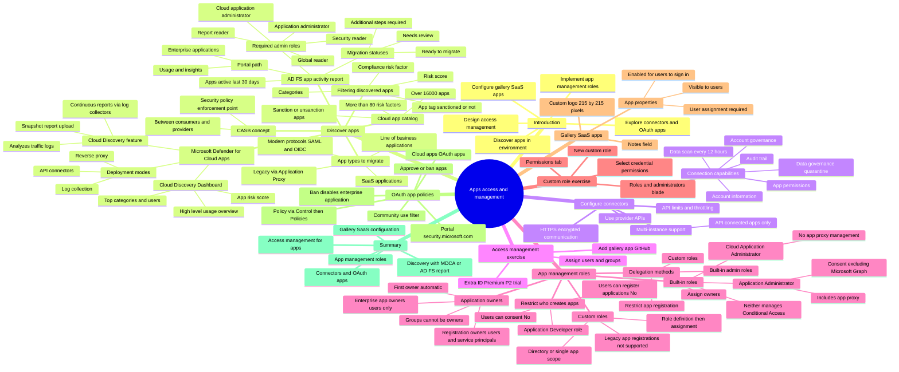

# Module 11: Discover apps by using Microsoft Defender for Cloud Apps and Active Directory Fe - Mind Map

Source lessons

- Introduction
- Discover apps by using Microsoft Defender for Cloud Apps and Active Directory Fe
- Configure connectors to apps
- Exercise implement access management for apps
- Design and implement app management roles
- Exercise create a custom role to manage app registration
- Configure preintegrated gallery SaaS apps
- Implement and manage policies for OAuth apps
- Summary and resources

