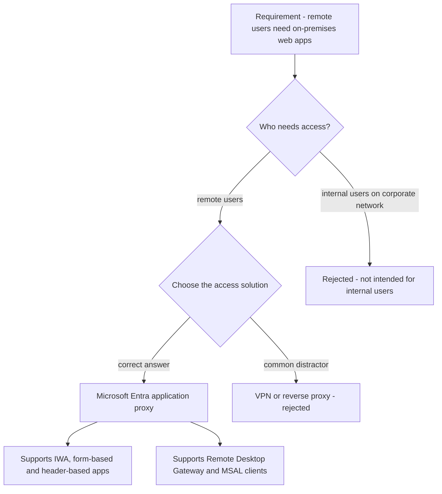
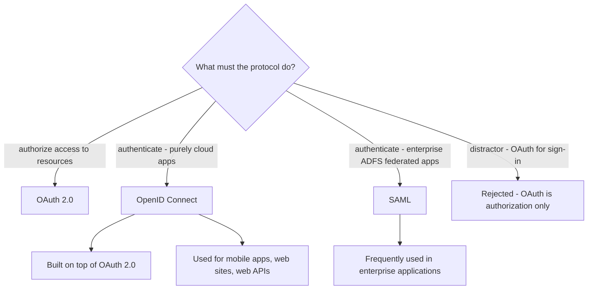
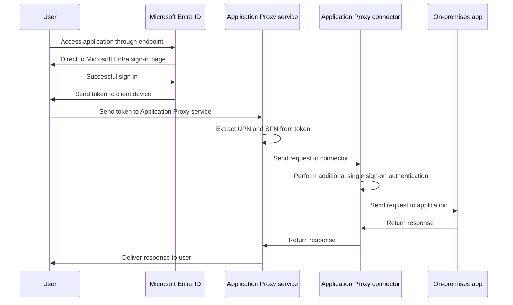
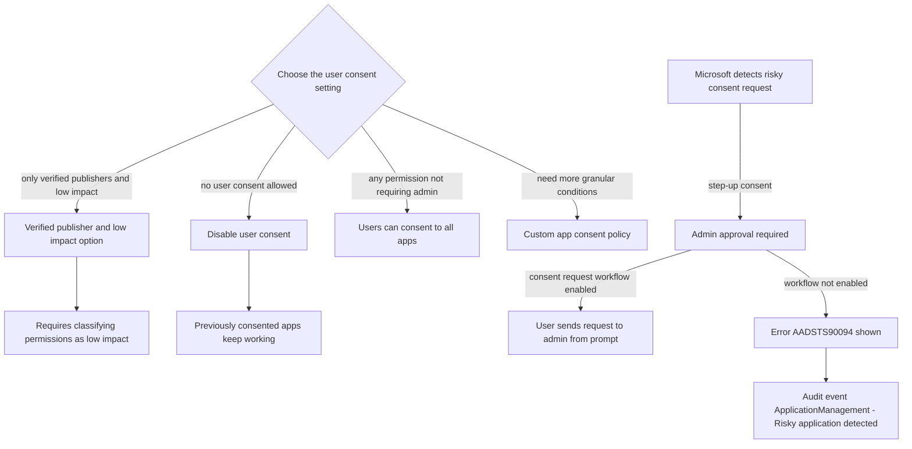
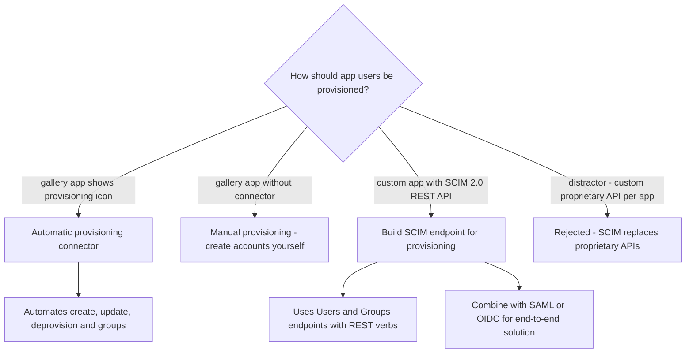

# Module 12: Implement token customizations - Diagrams

Source lessons

- Introduction
- Implement token customizations
- Implement and configure consent settings
- Integrate on-premises apps with Microsoft Entra application proxy
- Integrate custom SaaS apps for single sign-on
- Implement application-based user provisioning
- Monitor and audit access to Microsoft Entra integrated enterprise applications
- Create and manage application collections
- Summary and resources

### Choosing remote access for on-premises apps
Use this to answer exam questions asking which solution provides secure remote access to on-premises web apps and to eliminate the VPN and reverse proxy distractors.

### Selecting the correct SSO protocol
Use this when a question describes an app scenario and you must pick between OAuth 2.0, OpenID Connect and SAML without mixing up authentication and authorization.

### Application Proxy sign-in flow
Use this to reconstruct the exact order of the Application Proxy sign-in sequence, a common process-order question on the exam.

### Choosing user consent settings and risky consent handling
Use this to match a consent requirement to the correct setting and to recognize the AADSTS90094 error and the related audit event that appear in exam questions.

### Choosing a user provisioning method
Use this to decide between manual provisioning, automatic gallery provisioning and a custom SCIM endpoint, and to reject the proprietary API distractor.

