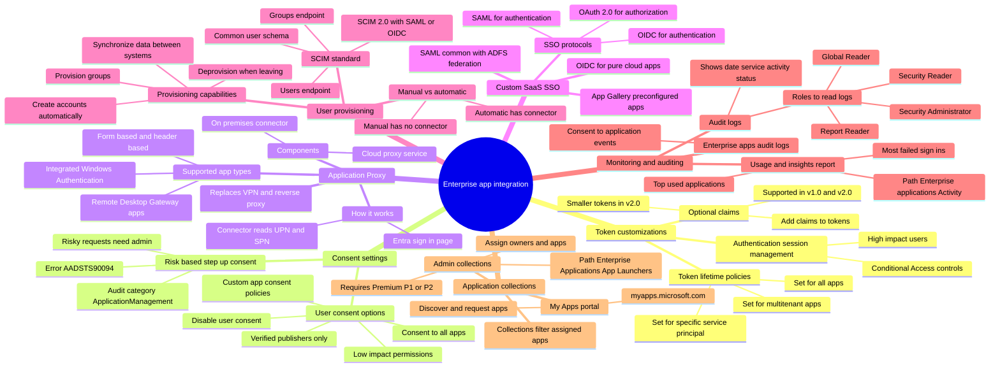

# Module 12: Implement token customizations - Mind Map

Source lessons

- Introduction
- Implement token customizations
- Implement and configure consent settings
- Integrate on-premises apps with Microsoft Entra application proxy
- Integrate custom SaaS apps for single sign-on
- Implement application-based user provisioning
- Monitor and audit access to Microsoft Entra integrated enterprise applications
- Create and manage application collections
- Summary and resources

