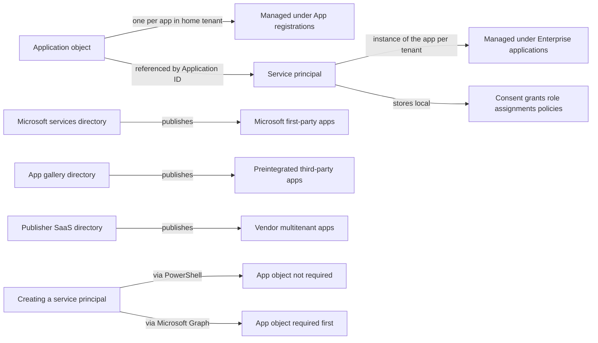
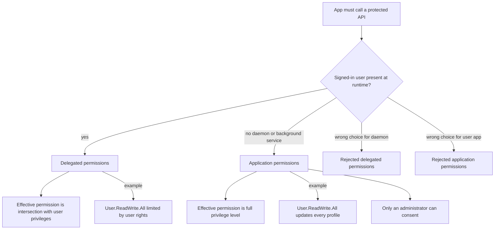
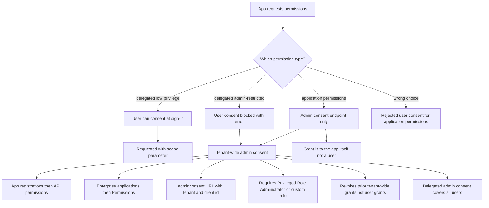
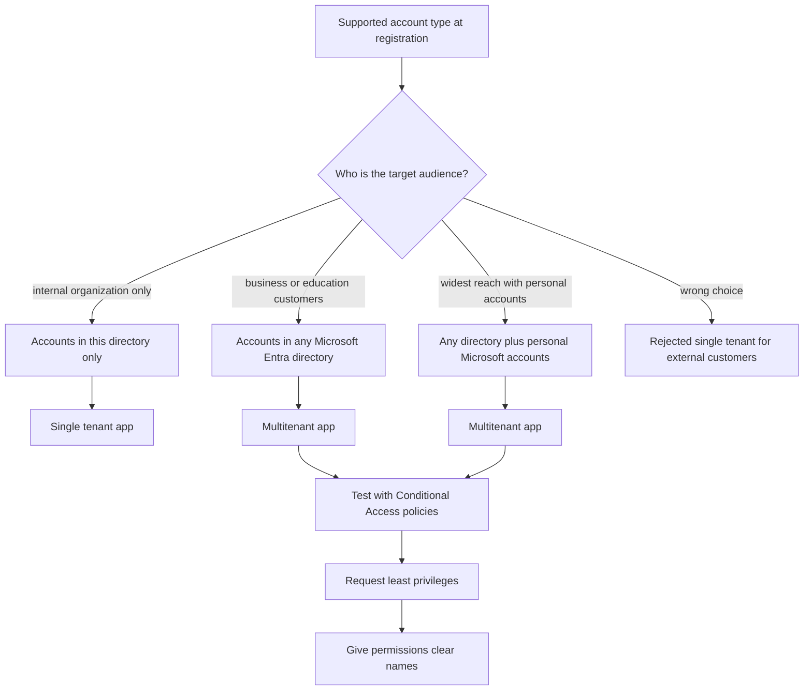
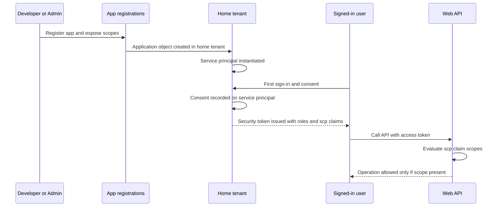

# Module 13: Plan your line of business application registration strategy - Diagrams

Source lessons

- Introduction
- Plan your line of business application registration strategy
- Implement application registration
- Register an application
- Configure permission for an application
- Grant tenant-wide admin consent to applications
- Implement application authorization
- Exercise add app roles to an application and receive tokens
- Manage and monitor application by using app governance
- Summary and resources

### Application object versus service principal architecture
Use this to answer exam questions about where each object lives, which portal blade manages it, and how they relate across tenants.

### Choosing between delegated and application permissions
Use this decision tree to pick the correct permission type when a question describes how the app runs, with the typical wrong answer shown as rejected.

### Choosing the correct consent path
Use this decision tree to select the right consent endpoint and portal path when a question mentions admin-restricted scopes or tenant-wide consent.

### Selecting the supported account type audience
Use this decision tree to map a described target audience to the correct single-tenant or multitenant setting during app registration.

### End-to-end registration consent and token flow
Use this sequence to recall the exact order of registration, service principal creation, consent, and token evaluation in exam scenarios.

