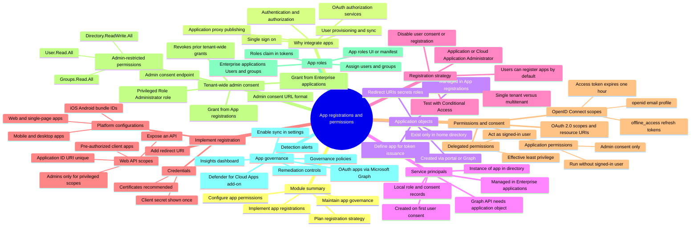

# Module 13: Plan your line of business application registration strategy - Mind Map

Source lessons

- Introduction
- Plan your line of business application registration strategy
- Implement application registration
- Register an application
- Configure permission for an application
- Grant tenant-wide admin consent to applications
- Implement application authorization
- Exercise add app roles to an application and receive tokens
- Manage and monitor application by using app governance
- Summary and resources

