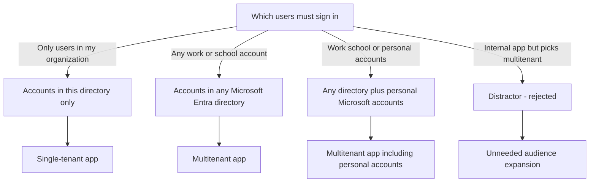
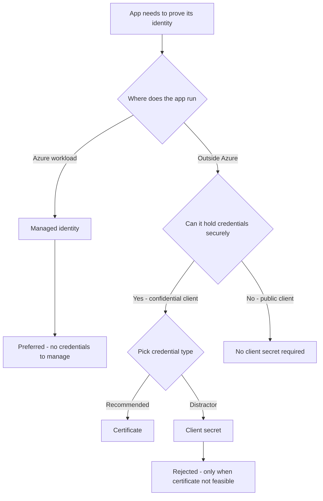
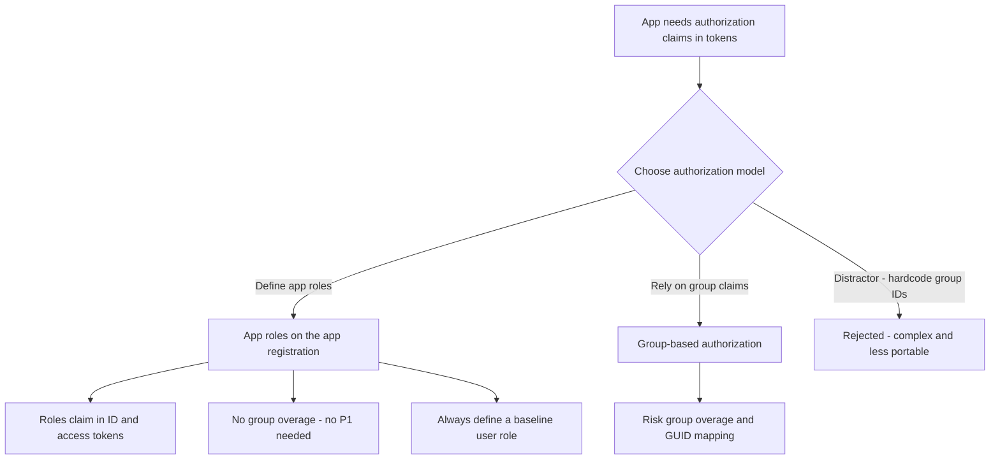
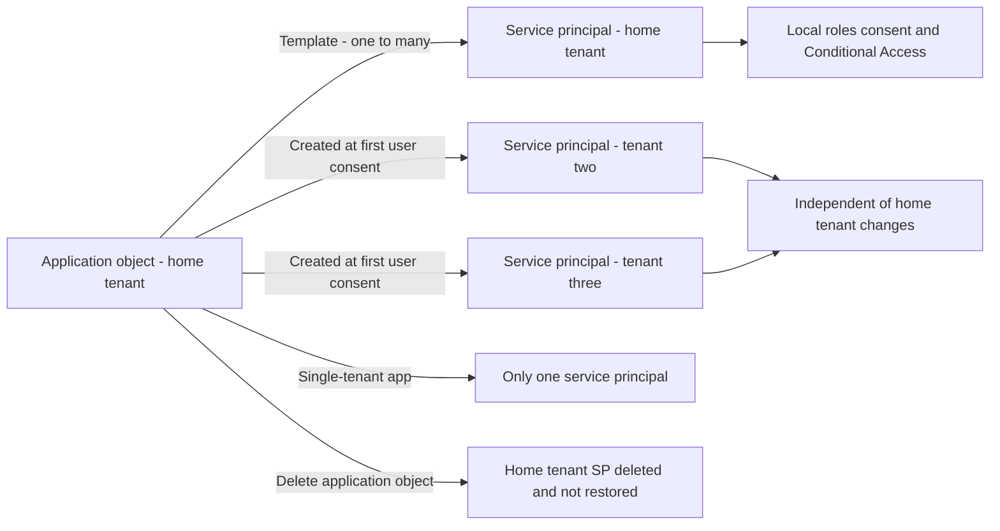
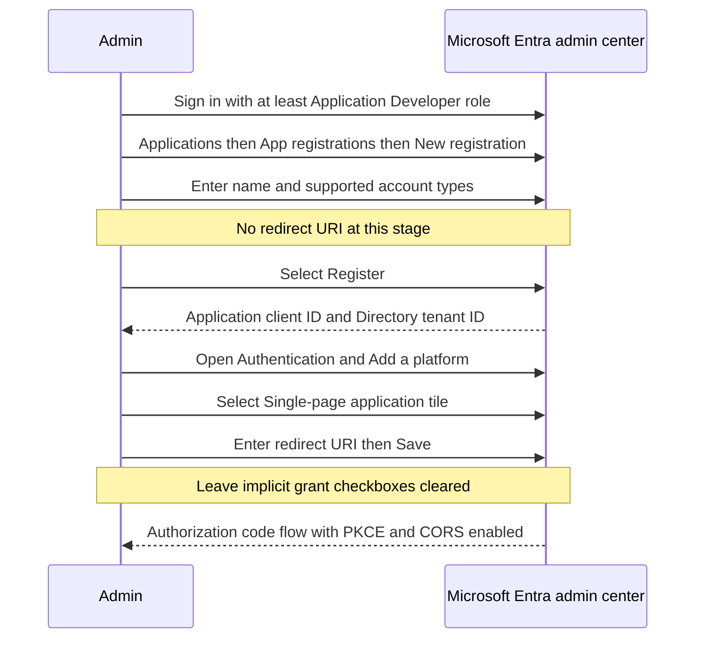

# Module 14: Plan for app registration - Diagrams

Source lessons

- Introduction
- Plan for app registration
- Explore application objects and service principals
- Create app registrations
- Configure app authentication
- Configure API permissions
- Create app roles
- Summary

### Decision tree - Choosing supported account types
Useful when the exam gives an audience scenario and asks which supported account type to select, including the classic multitenant distractor.

### Decision tree - Choosing the credential type for an app
Useful for questions on how a confidential client proves its identity and why certificates or managed identities beat client secrets.

### Decision tree - App roles versus group-based authorization
Useful when a question contrasts app roles with group claims, group overage, code complexity and licensing implications.

### Architecture - Application object versus service principals
Useful for questions on where each object lives, how service principals are created per tenant, and what deletion or restore does.

### Process - Registering a single-page application
Useful to memorize the exact admin-center path, the values to record, and the platform settings for a SPA registration.

