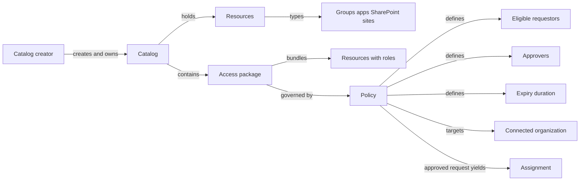
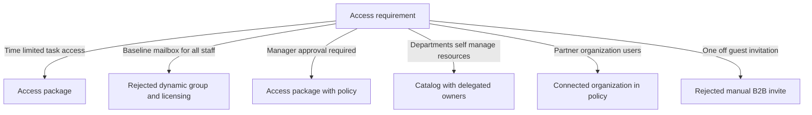
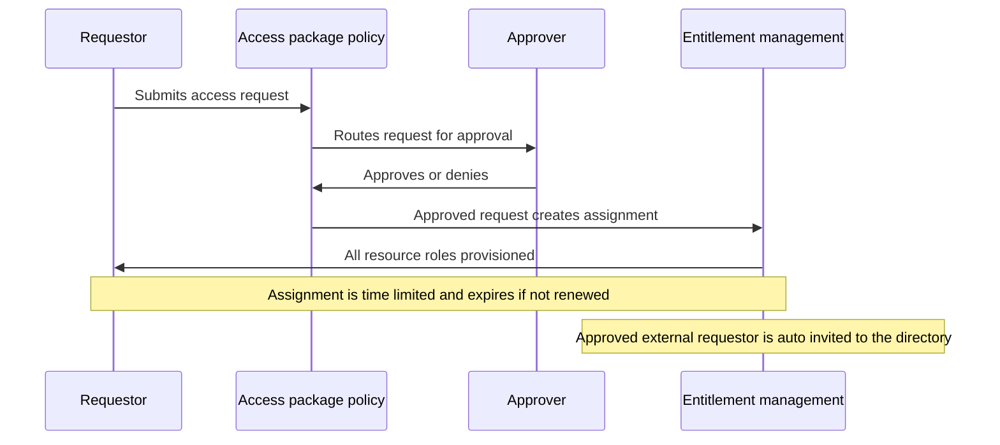
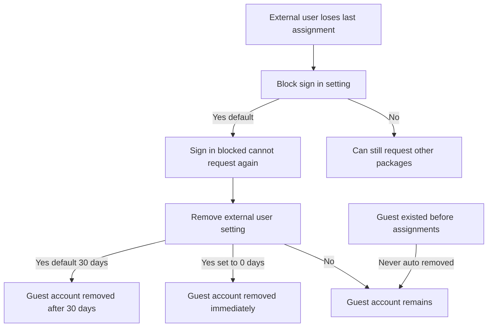
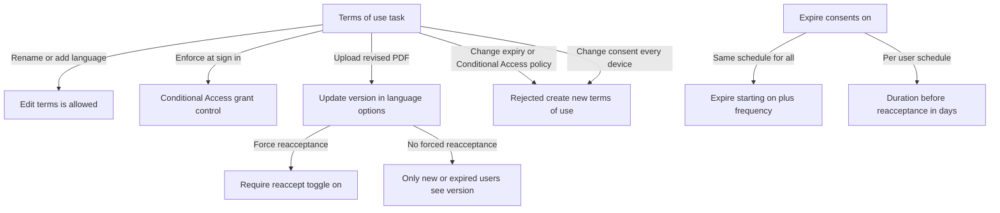

# Module 15: Define access packages - Diagrams

Source lessons

- Introduction
- Define access packages
- Exercise create and manage a resource catalog with Microsoft Entra entitlement m
- Configure entitlement management
- Exercise add terms of use acceptance report
- Exercise manage the lifecycle of external users with Microsoft Entra identity go
- Configure and manage connected organizations
- Review per-user entitlements
- Summary and resources

### Entitlement management object hierarchy
Use this to quickly recall how catalogs, access packages, policies, resources and assignments nest, a frequent terminology question on the exam.

### Decision tree choosing the correct entitlement feature
Use this to map an exam requirement to the correct feature while avoiding the classic dynamic group and manual B2B distractors.

### Access package request and approval workflow
Use this to trace the end to end request, approval, assignment and expiry flow that scenario questions describe.

### Decision tree external user lifecycle after last assignment
Use this to answer lifecycle questions about what happens when an external user loses their last access package assignment, including the default 30 day removal.

### Decision tree terms of use configuration and edits
Use this to distinguish which terms of use settings can be edited versus which force creating a new terms of use.

