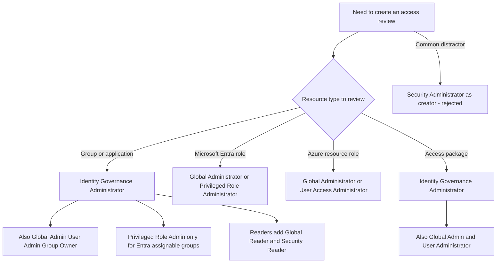
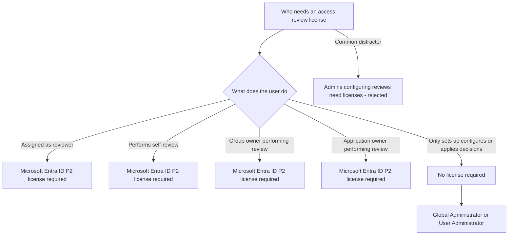
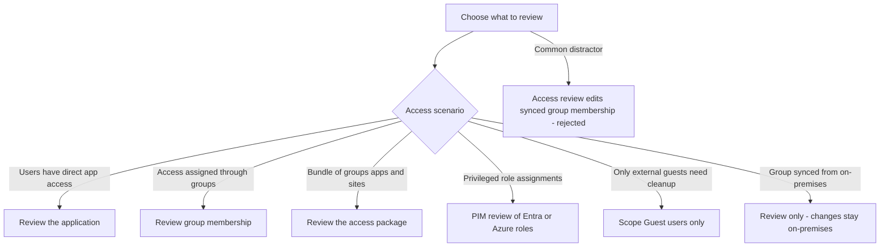
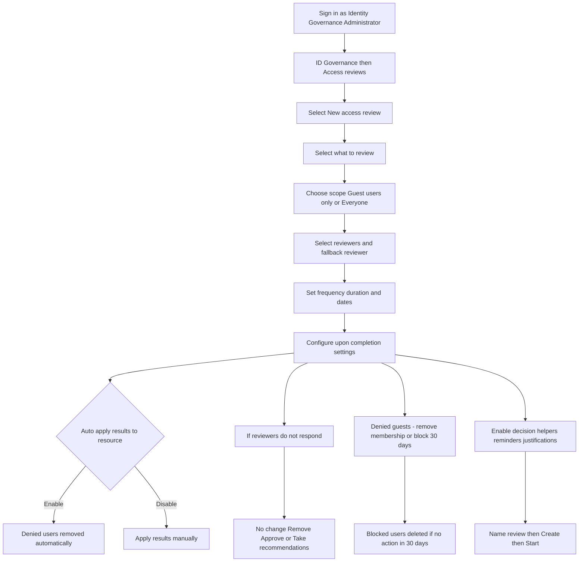
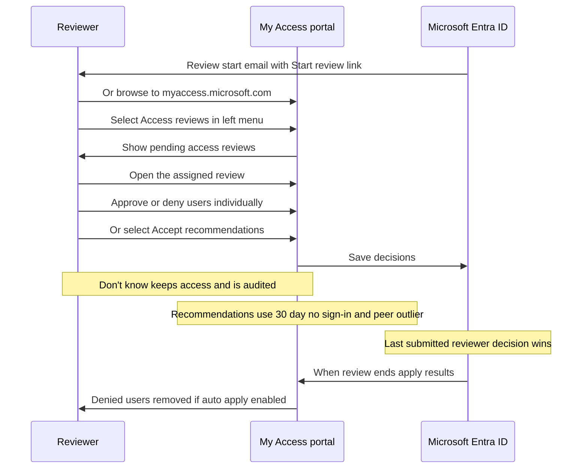

# Module 16: Plan for access reviews - Diagrams

Source lessons

- Introduction
- Plan for access reviews
- Create access reviews for groups and apps
- Create and configure access reviews programmatically
- Monitor access review findings
- Automate access review management tasks
- Configure recurring access reviews
- Explore the Access Review Agent in Microsoft Entra
- Summary and resources

### Decision tree: Admin roles required per resource type
Use this to instantly match the resource being reviewed to the roles that can create the review and to reject the Security Administrator distractor.

### Decision tree: Licensing for access reviews
Use this to resolve licensing questions, since only reviewers and self-reviewers need Microsoft Entra ID P2 while admins who configure reviews do not.

### Decision tree: Choosing what to review
Use this to pick the correct review target from an exam requirement and to avoid the classic trap that access reviews can change on-premises synced groups.

### Process: Creating an access review in the portal
Use this to memorize the exact portal path, creation steps, and the upon-completion settings that are heavily tested.

### Sequence: Reviewer completes an access review
Use this to remember the My Access portal reviewer flow, the two recommendation types, and the last-decision-wins rule.

