# Module 16: Plan for access reviews - Mind Map

Source lessons

- Introduction
- Plan for access reviews
- Create access reviews for groups and apps
- Create and configure access reviews programmatically
- Monitor access review findings
- Automate access review management tasks
- Configure recurring access reviews
- Explore the Access Review Agent in Microsoft Entra
- Summary and resources

```mermaid
mindmap
  root((Access Reviews Module))
    Planning Access Reviews
      What is an Access Review
        Planned review of user access
        Right people right access right resources
        Requires Entra ID Governance license
        Some capabilities work with P2
        Entra Suite also qualifies
      Engage Stakeholders
        IT administration
        Security teams
        Development teams
        Business units
        Corporate governance
      Four Governance Questions
        Who should have access
        What users do with access
        Are controls effective
        Can auditors verify controls
      Pilot Recommendations
        Start with noncritical resources
        No auto apply initially
        Document removed access
        Monitor audit logs
      Resource Types Reviewed
        Apps with SSO
        Group memberships
        Access packages
        Entra roles and Azure roles
        Custom data resources preview
    Roles and Licensing
      Create and Manage Reviews
        Global Administrator
        Identity Governance Administrator
        User Administrator
        Privileged Role Administrator
        Group Owner
        User Access Administrator for Azure roles
      Read Review Results
        Global Reader
        Security Reader
        Resource Owner
      Licensing Rules
        P2 for reviewers and self reviewers
        P2 for group and app owners reviewing
        No license for admins configuring reviews
    Create Reviews for Groups and Apps
      Portal Path
        ID Governance then Access reviews
        New access review
        Identity Governance Administrator needed
      Teams and Groups Options
        All Microsoft 365 groups with guest users
        Select teams plus groups
      Scope Options
        Guest users only
        Everyone
        Inactive users up to 730 days
      Reviewer Selection
        Group owners
        Selected users or groups
        Users review own access
        Managers of users
        Fallback reviewers
      Recurrence Settings
        Weekly Monthly Quarterly
        Semi-annually Annually
        Monthly max duration 27 days
      Upon Completion Settings
        Auto apply results to resource
        No change
        Remove access
        Approve access
        Take recommendations
      Denied Guest User Actions
        Remove membership from resource
        Block sign in 30 days then remove
      Review Statuses
        NotStarted Initializing Starting
        InProgress Completing
        Auto-Reviewing Auto-Reviewed
        Applying Applied Failed
    Programmatic Management
      Microsoft Graph API
        AccessReview.ReadWrite.All permission
        Create access review schedule definition
        AccessReview.Read.All for read
        Use Graph Explorer for testing
      PowerShell
        New-MgIdentityGovernanceAccessReviewDefinition
      API Automation Tasks
        Create and start reviews
        End review early
        List running reviews
        Collect decisions
    Monitor Findings
      My Access Portal
        myaccess.microsoft.com
        Access reviews left menu
      Decision Options
        Approve Deny
        Don't know keeps access
        Last reviewer response recorded
      Recommendations
        No sign-in within 30 days
        Peer outlier analysis
        Accept recommendations in bulk
    Automation and Guests
      Auto Apply Results
        Denied users removed automatically
        Removal of membership assignment or elevation
      Guest User Reviews
        Review Everyone or Guest users only
        External identities via B2B
        Sources of guest access
        Groups Teams apps packages roles
      On-Premises Groups
        Cannot change synced memberships
        Source of authority is on-premises
        Results via CSV or Graph
    Recurring Reviews
      Series End Options
        Never
        Specific end date
        Number of occurrences
      Updating a Series
        Apply to Current instance
        Apply to Series
        Replace departed reviewers
    Access Review Agent
      Overview
        AI guided reviews in Teams
        Natural language decisions
        Generates approve deny with justification
      Signals Used
        User inactivity
        User-to-Group affiliation
        Account enabled
        Employment status
        Lifecycle workflow history
        Previous review decisions
        Access request history
      Prerequisites
        Entra ID Governance or Suite
        Security Copilot with one SCU
        Identity Governance Administrator
        Lifecycle Workflows Administrator
        Security Copilot Contributor
        Reviewers need Teams access
      Limitations and Enablement
        Cannot stop or pause agent
        Start from Entra admin center Agents
        Enable in review Advanced Settings
    Monitoring and Communications
      Audit Logs
        Category Policy
        Create Update Delete reviews
        Approve Deny Reset Apply decisions
        Export to Log Analytics or Event Hubs
      Reviewer Emails
        Reminder halfway before expiry
        Customize additional content
        My Access portal for reviewers
```

