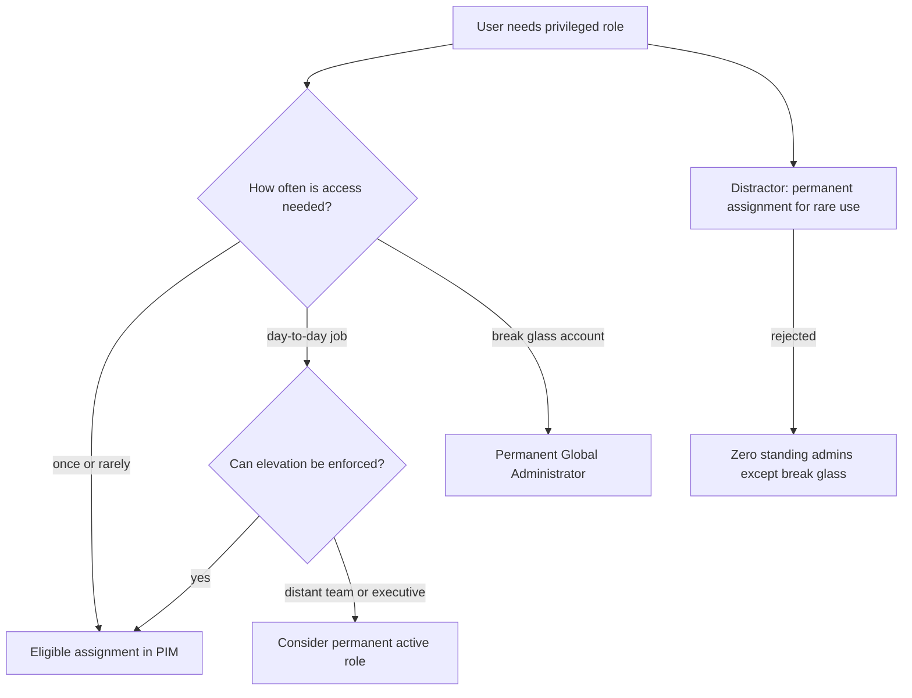
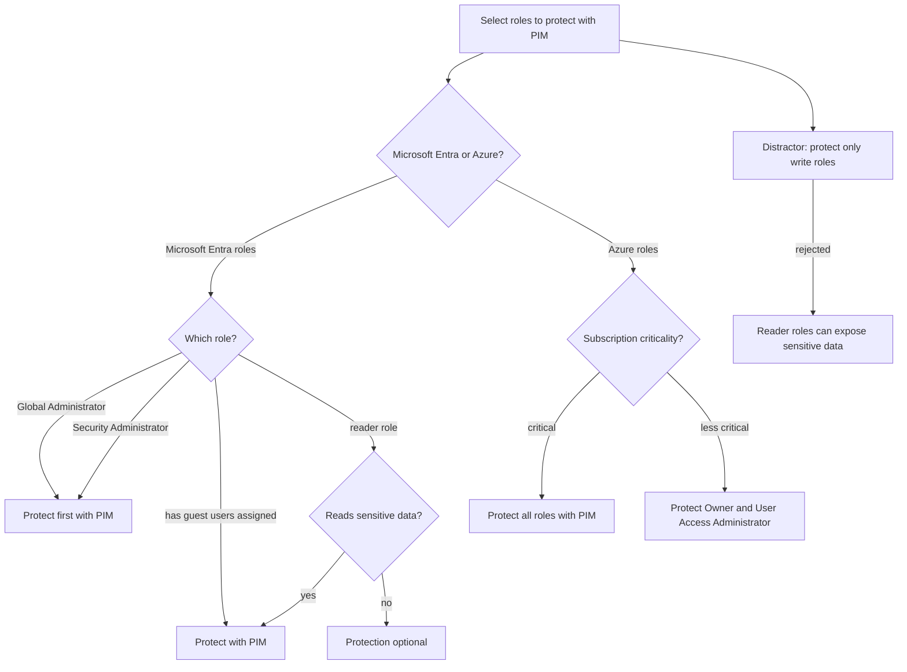
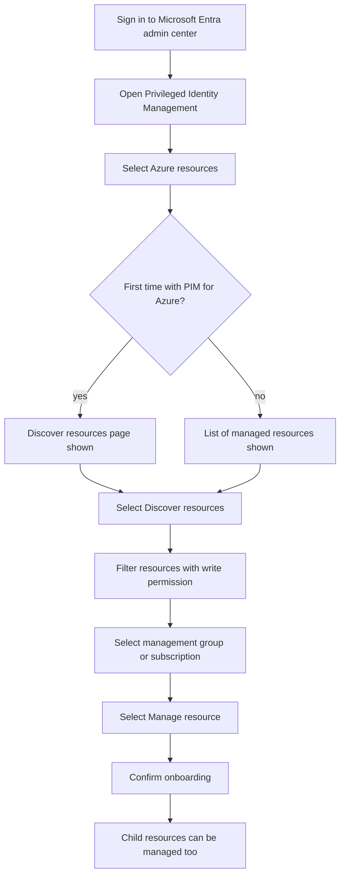
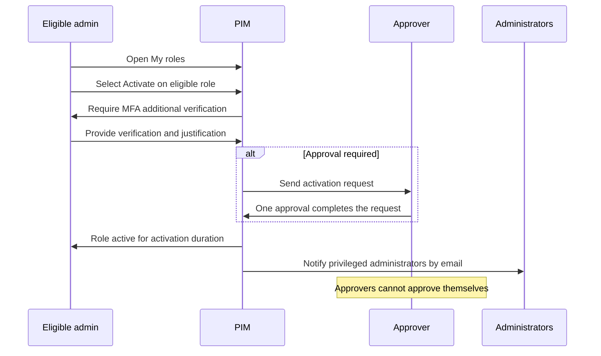
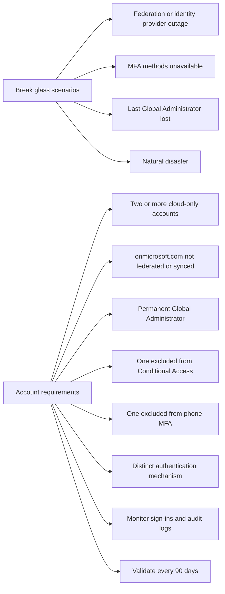

# Module 17: Define a privileged access strategy for administrative users - Diagrams

Source lessons

- Introduction
- Define a privileged access strategy for administrative users
- Configure Privileged Identity Management for Azure resources
- Exercise configure Privileged Identity Management for Microsoft Entra roles
- Exercise assign Microsoft Entra roles in Privileged Identity Management
- Exercise assign Azure resource roles in Privileged Identity Management
- Plan and configure Privileged Access Groups
- Analyze Privileged Identity Management audit history and reports
- Create and manage emergency access accounts
- Summary and resources

### Diagram 1: Eligible vs Active vs Permanent Assignment Decision Tree
Use this when the exam asks which assignment type fits a user who needs a role rarely, daily, or for emergencies, and to eliminate the standing-access distractor.

### Diagram 2: Which Roles to Protect with PIM Decision Tree
Use this to select the roles Microsoft recommends onboarding to PIM first and to reject the distractor that reader roles never need protection.

### Diagram 3: Onboarding Azure Resources into PIM Process
Use this to recall the exact portal path and steps for discovering and managing Azure resources in PIM.

### Diagram 4: Activating an Eligible Role in PIM
Use this to remember the activation flow including mandatory MFA, justification, single-approver completion, and activation notifications.

### Diagram 5: Emergency Access Accounts Scenarios and Requirements
Use this to answer break-glass account questions about when they are needed, how they must be configured, and how often to validate them.

