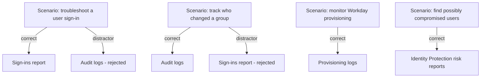
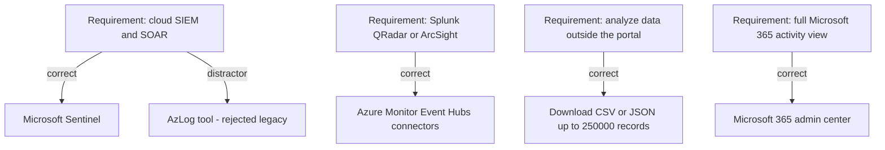
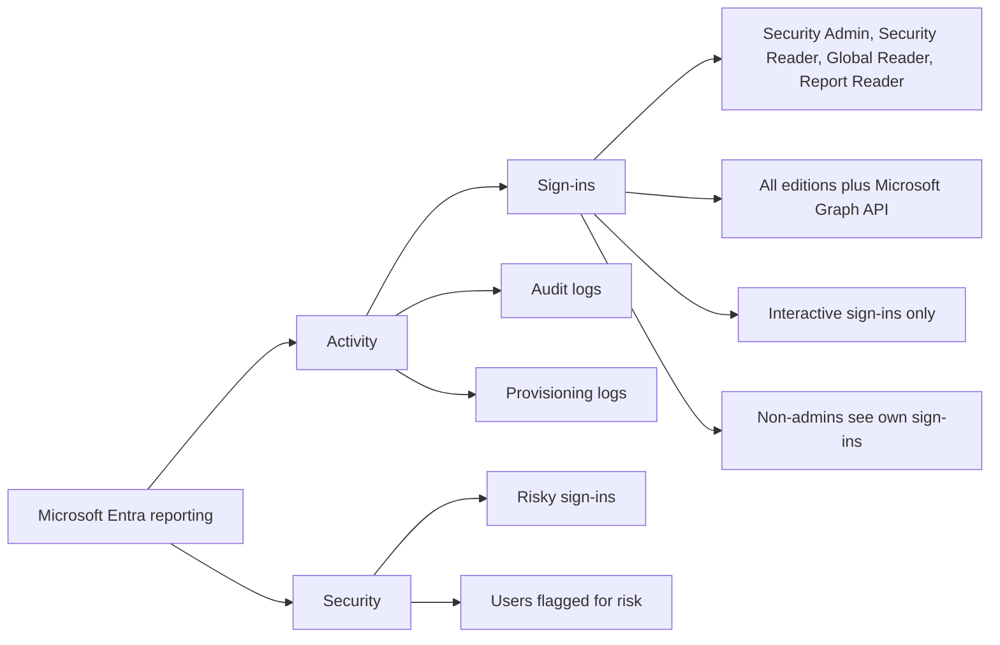
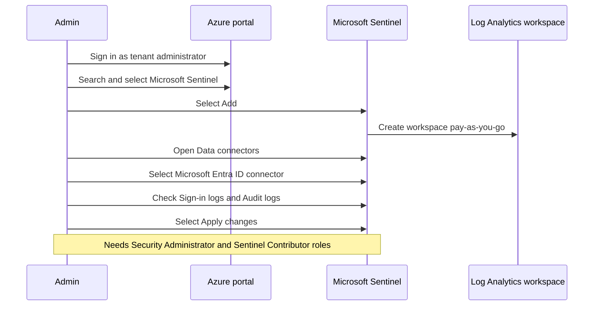
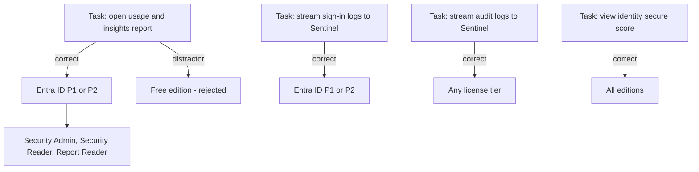

# Module 18: Analyze and investigate sign-in logs to troubleshoot access issues - Diagrams

Source lessons

- Introduction
- Analyze and investigate sign-in logs to troubleshoot access issues
- Review and monitor Microsoft Entra audit logs
- Exercise connect data from Microsoft Entra ID to Microsoft Sentinel
- Export logs to third-party security information and event management system
- Analyze Microsoft Entra workbooks and reporting
- Monitor security posture with Identity Secure Score
- Summary and resources

### Choosing the correct Entra log type
Use this to map an exam scenario describing a monitoring need to the correct log type while avoiding the classic distractor of picking audit logs for sign-in troubleshooting.

### Deciding where to route Entra logs
Use this when a question asks where sign-in or audit data should be delivered, since the exam tests Sentinel versus third-party SIEM versus manual download and the deprecated AzLog distractor.

### Reporting architecture and access
Use this to recall the reporting architecture components and which roles and licenses unlock each report.

### Connecting Microsoft Entra ID to Microsoft Sentinel
Use this to memorize the exact portal click path and role prerequisites for streaming Entra logs into Sentinel.

### License and role requirements per task
Use this to lock in the license tier and role combinations that the exam frequently mixes up as distractors.

