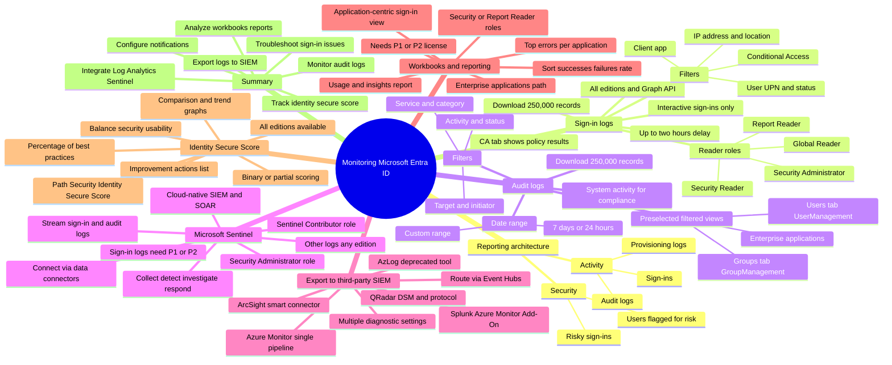

# Module 18: Analyze and investigate sign-in logs to troubleshoot access issues - Mind Map

Source lessons

- Introduction
- Analyze and investigate sign-in logs to troubleshoot access issues
- Review and monitor Microsoft Entra audit logs
- Exercise connect data from Microsoft Entra ID to Microsoft Sentinel
- Export logs to third-party security information and event management system
- Analyze Microsoft Entra workbooks and reporting
- Monitor security posture with Identity Secure Score
- Summary and resources

